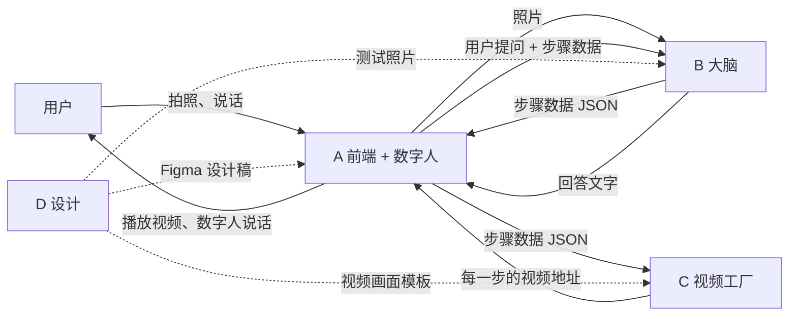

# HomeGuide（暂定名）：拍一张照片，用母语学会用家电

> Imperial AI Hackathon 2026 · 主赛道 02 Voice, Vision & Generative Media
> 子奖：**fal** + **Anam**　｜　交叉奖：**Adaption**、**Figma**

## 1. 项目简介

在英国，很多人的母语不是英语：国际学生、新移民、移民老人、短期访客。宿舍里的洗衣机、出租屋里的烤箱和暖气调节器，面板上全是英文缩写，很容易用错。

**HomeGuide** 的用法：

1. 打开 App，数字人老师用你的母语打招呼。
2. 对着家电控制面板拍一张照片。
3. AI 识别家电和按钮，写出分步说明。
4. 生成一段**母语讲解视频**：在真实照片上标出要按的按钮，讲解员口型同步，带双语字幕。
5. 边看边问：每一步视频停下来，可以说"下一步""再说一遍""这个按钮是干什么的"，数字人实时回答。

**安全设计**

- 标注框用**代码**画在**真实照片**上，不让 AI 凭空生成家电画面，避免标错按钮。
- **检查员 AI** 逐步核对，和照片对不上的步骤直接删除。
- **红线**：燃气、电路维修、拆修锅炉等操作不生成教程，只给出官方售后或房东的联系方式。
- 不确定时诚实地说"我不确定"，绝不编造。

---

## 2. 每个工具负责什么

| 工具 | 一句话 | 具体负责 | 不负责 |
|---|---|---|---|
| **Anam** | 数字人的**脸和实时对话** | 屏幕上的数字人老师；听用户说话、实时回答；**调用工具**：拍照、播放第 N 步、下一步、重放 | 生成教程视频里的讲解员（那是 fal） |
| **ElevenLabs** | **声音**（可选） | 如果 Anam 自带的声音在某种语言上不够自然，就用它替换数字人的声音 | 不是数字人的脸 |
| **Claude** | **大脑** | 看照片、认型号、读按钮；写分步说明并翻译；当检查员；判断红线；回答用户提问 | 不生成图像、视频、声音 |
| **fal** | **生成视频里的素材** | 母语语音旁白；讲解员**口型同步**；照片的轻微动画 | 不画标注框（用代码画）；不负责拼接视频（用 ffmpeg） |
| **ffmpeg** | **拼接视频** | 把标注后的照片、讲解员、语音、双语字幕合成为每一步的视频 | |
| **Figma** | **界面设计稿** | 手机界面、视频画面模板、二维码贴纸的样式 | 不写代码：前端代码由 A 实现 |
| **Adaption** | **微调一个小模型，冲交叉奖** | 用平台生成"英文家电说明 → 简单母语分步说明"的数据，微调小模型，看排行榜上的提升 | **不接入主系统**（平台暂不支持在线调用微调后的模型） |

---

## 3. 分工

| 成员 | 角色 | 工具 | 负责的代码目录 |
|---|---|---|---|
| **A** | 前端 + 数字人 | Anam、ElevenLabs | `frontend/` |
| **B** | 大脑 | Claude、Python | `backend/brain/` |
| **C** | 视频工厂 | fal、Python、ffmpeg | `backend/video/` |
| **D** | 设计 + 交叉奖 + 演示 | Figma、Adaption | `design/`、`docs/` |

如果只有 3 个人：Figma 归 A，Adaption 和 PPT 归 B。

---

## 4. 谁的数据交给谁



| # | 从 | 交给 | 内容 | 格式 | 什么时候 |
|---|---|---|---|---|---|
| 1 | 用户 | A | 家电照片 | JPG / PNG | 运行时 |
| 2 | A | B | 照片 + 用户语言 | 调用 `POST /analyze` | 运行时 |
| 3 | B | A | **步骤数据** | JSON（见第 5 节） | 运行时 |
| 4 | A | C | 步骤数据 | 调用 `POST /render` | 运行时 |
| 5 | C | A | 每一步的视频地址 | JSON：视频 URL 列表 | 运行时 |
| 6 | A | B | 用户提问 + 步骤数据 | 调用 `POST /ask` | 运行时 |
| 7 | B | A | 回答文字（母语） | JSON | 运行时 |
| 8 | B | A | 红线提示：原因 + 官方联系方式 | 步骤数据里 `safety = "blocked"` | 运行时 |
| 9 | B | **全队** | **样例步骤数据** | `samples/sample_steps.json` | **周六 16:15 前** |
| 10 | D | B | 3 台真实家电的照片 | `samples/photos/` | **周六 16:15 前** |
| 11 | D | A、C | 界面设计稿 + 视频画面模板 | Figma 链接，写在 `design/README.md` | **周六 17:00 前** |

> **规则：所有人先用样例数据开发，不等别人。**
> A 用任意一段视频测试播放控制；C 用 `sample_steps.json` 生成视频；B 用网上找的家电面板图先测。周六 20:00 再换成真实数据。

---

## 5. 步骤数据格式（B 输出，A、C 使用）

```json
{
  "appliance": "washing machine",
  "model": "Beko WTL84141W",
  "language": "zh",
  "safety": "ok",
  "safety_message": "",
  "steps": [
    {
      "n": 1,
      "button_en": "Cotton 40°",
      "box": [320, 180, 60, 40],
      "say_native": "第一步：把旋钮转到 Cotton 40 度，这是洗普通棉质衣服的模式。",
      "subtitle_native": "把旋钮转到 Cotton 40°",
      "subtitle_en": "Turn the dial to Cotton 40°"
    }
  ]
}
```

| 字段 | 说明 |
|---|---|
| `language` | 用户母语，例如 `zh`（中文）、`pl`（波兰语） |
| `safety` | `"ok"` 正常生成；`"blocked"` 越过红线，不生成教程 |
| `safety_message` | 被拦截时，数字人要说的话（原因 + 官方联系方式） |
| `box` | 按钮在照片上的位置：`[左上角 x, 左上角 y, 宽, 高]`，单位是像素 |
| `say_native` | 讲解员要念的母语旁白 |
| `subtitle_native` / `subtitle_en` | 双语字幕 |

**改格式之前必须先在群里说**，因为 A、B、C 三个人都依赖它。

---

## 6. 接口约定

后端是一个 Python 服务。B 负责 `/analyze` 和 `/ask`，C 负责 `/render`。

### `POST /analyze`（B）
- 输入：照片文件 + `language`
- 输出：步骤数据 JSON（第 5 节）

### `POST /render`（C）
- 输入：步骤数据 JSON + 原始照片
- 输出：
```json
{ "videos": [ { "n": 1, "url": "/media/abc123_step1.mp4" } ] }
```

### `POST /ask`（B）
- 输入：
```json
{ "question": "这个按钮是干什么的？", "steps": { "...": "步骤数据" }, "current_step": 1 }
```
- 输出：
```json
{ "answer": "这是快速洗模式，大约 30 分钟。" }
```

---

## 7. 时间表与同步点

| 时间 | A 前端 + 数字人 | B 大脑 | C 视频工厂 | D 设计 + 交叉奖 |
|---|---|---|---|---|
| **周六 15:50–16:15** | 注册 Anam，跑通官方示例 | 手写样例步骤数据，提交到 `samples/` | 注册 fal；问 fal 的智能体该用哪些模型 | 拍 3 台家电照片；启动 Adaption 数据生成 |
| 🚩 **16:15 同步** | 样例数据、照片、API key 全部就位 | | | |
| **16:15–20:00** | 网页 + 数字人说中文；定义工具；用假视频测试播放 | 照片 → 步骤数据；测按钮位置准不准 | 样例数据 → 每步视频 | Figma 设计稿 17:00 前交出；检查 Adaption 数据 |
| 🚩 **20:00 同步** | A 页面能交互，B 能处理真实照片，C 能出完整视频 | | | |
| **20:00–23:00** | 接入 B、C 的接口 | 检查员 + 安全红线；封装接口 | 封装接口；加缓存 | 启动 Adaption 微调；PPT 初稿；当测试用户 |
| 🚩 **23:00 同步** | **端到端跑通，粗糙也行** | | | |
| **周日 9:00–12:00** | 提问功能；等待时陪聊；套用设计 | 问答；加波兰语 | 波兰语语音和口型；双语字幕 | 看排行榜；二维码页面；PPT 定稿 |
| 🚩 **12:00 同步** | **功能冻结，录备用演示视频** | | | |
| **周日下午** | 现场操作 | 准备技术问答 | 只修 bug | 主讲 |

**周日上午的优先级**
1. 演示路线稳定：同一条路线跑 5 到 10 遍不出错；处理慢和失败的情况。
2. 亮点：边看边问、第二种语言、红线演示、视频画面。
3. 有时间才做：二维码、缓存、整体美化。

如果周六晚上没跑通，周日上午**只做串联**，第 3 级全部砍掉。

---

## 8. 目录结构

```
.
├── README.md
├── .env.example          # API key 的模板（不含真实 key）
├── frontend/             # A：网页 + Anam 数字人
├── backend/
│   ├── main.py           # 后端入口，挂载下面两个模块
│   ├── brain/            # B：/analyze、/ask，Claude 提示词
│   └── video/            # C：/render，fal + ffmpeg
├── samples/
│   ├── sample_steps.json # B 写的样例步骤数据
│   └── photos/           # D 拍的测试照片
├── design/               # D：Figma 链接、截图
└── docs/                 # D：演示脚本、PPT
```

## 9. API key

需要的 key：`ANAM_API_KEY`、`ANTHROPIC_API_KEY`、`FAL_KEY`、`ELEVENLABS_API_KEY`（可选）。

- 复制 `.env.example` 为 `.env`，填入自己的 key。
- ⚠️ **`.env` 已写入 `.gitignore`，绝对不要把真实的 key 提交到 GitHub。** 仓库一旦公开，key 会被别人盗用，额度很快被刷光。

---

## 10. 三分钟演示脚本

1. **（30 秒）痛点**：刚到伦敦的留学生第一次用宿舍洗衣机，面板全是英文缩写，把毛衣洗缩了。
2. **（90 秒）现场演示**：拍照 → 数字人用中文说"稍等，我给你准备教程" → 播放视频，照片上标出按钮，讲解员用中文讲解 → 用户问"羊毛衣服选哪个模式"，数字人实时回答。
3. **（30 秒）换人换语言**：同一台洗衣机切换成波兰语；再展示一张燃气锅炉照片被红线拦截。
4. **（30 秒）商业模式与技术**：宿舍和房东用二维码贴纸；每个赞助商工具用在哪里；Adaption 排行榜结果。
