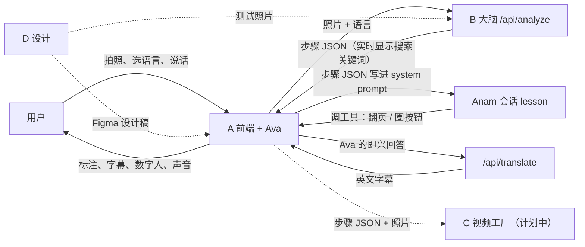

# 家电小老师 HomeGuide：拍一张照片，用母语学会用家电

> Imperial AI Hackathon 2026 · 主赛道 02 Voice, Vision & Generative Media
> 子奖：**fal** + **Anam**　｜　交叉奖：**Adaption**、**Figma**

## 1. 项目简介

在英国，很多人的母语不是英语：国际学生、新移民、移民老人、短期访客。宿舍里的洗衣机、出租屋里的烤箱和暖气调节器，面板上全是英文缩写，很容易用错。

**怎么用：**

1. 打开 App，数字人老师 **Ava** 用你的母语打招呼。
2. 对着家电控制面板拍一张照片。
3. AI 识别品牌、型号和按钮，联网查说明书，写出分步说明。
4. 在**真实照片上标出要按的按钮**，Ava **口型同步**讲解，带**双语字幕**。
5. 边看边问：每一步停下来，可以说"下一步""再说一遍""这个按钮是干什么的"，Ava 实时回答。

**安全设计**

- 标注框用**代码**画在**真实照片**上，不让 AI 凭空生成家电画面，避免标错按钮。
- 每一步都附**资料来源**（官网说明书 / 论坛）；**检查员 AI** 逐步核对，和照片对不上的步骤直接删除。
- **红线**：燃气、电路维修、拆修锅炉等操作不生成教程，只给出官方售后或房东的联系方式。
- 不确定时诚实地说"我不确定"，绝不编造（步骤数据里有 `model_confidence` 字段）。

---

## 2. 快速开始

```bash
npm install
cp .env.example .env   # 填入 ANTHROPIC_API_KEY 和 ANAM_API_KEY
npm start              # http://localhost:8000
```

- 没有填密钥也能跑：自动进入**演示模式**（示例日文洗衣机面板 + Ava 形象照 + 浏览器朗读），方便先看效果。
- 手机上使用需要 HTTPS（相机 / 麦克风权限）：部署到任意 HTTPS 主机，或本地用 `ngrok http 8000` 之类的隧道。

---

## 3. 每个工具负责什么

| 工具 | 一句话 | 具体负责 | 不负责 |
|---|---|---|---|
| **Anam** | 数字人的**脸和实时对话** | 屏幕上的 Ava；听用户说话、实时回答、口型同步；**调用客户端工具**翻页、圈按钮 | 不看照片、不写步骤 |
| **ElevenLabs** | **声音**（可选） | 如果 Anam 自带的声音在某种语言上不够自然，就用它替换 | 不是数字人的脸 |
| **Claude** | **大脑** | 看照片、认型号、联网查说明书、写分步说明并翻译；当检查员；判断红线；给 Ava 的即兴回答补英文字幕 | 不生成图像、视频、声音 |
| **fal** | **生成视频素材**（计划中） | 离线教程视频里的母语旁白、讲解员口型同步、照片轻微动画 | 不画标注框（用代码画）；不拼接视频（用 ffmpeg） |
| **ffmpeg** | **拼接视频**（计划中） | 把标注照片、讲解员、语音、双语字幕合成为每一步的视频 | |
| **Figma** | **界面设计稿** | 手机界面、视频画面模板、二维码贴纸的样式 | 不写代码 |
| **Adaption** | **微调一个小模型，冲交叉奖** | 生成"英文家电说明 → 简单母语分步说明"的数据，微调小模型，看排行榜提升 | **不接入主系统**（平台暂不支持在线调用微调后的模型） |

---

## 4. 分工

| 成员 | 角色 | 工具 | 负责的文件 |
|---|---|---|---|
| **A** | 前端 + 数字人 | Anam、ElevenLabs | `public/`、`persona.js`、`languages.js` |
| **B** | 大脑 | Claude | `server.js` 里的 `/api/analyze`、`/api/translate`、提示词 |
| **C** | 视频工厂 | fal、ffmpeg | 讲解视频导出（浏览器录制 + 计划中的 `/api/render`） |
| **D** | 设计 + 交叉奖 + 演示 | Figma、Adaption | `design/`、`docs/` |

如果只有 3 个人：Figma 归 A，Adaption 和 PPT 归 B。

---

## 5. 数据流



### 输入用在哪

| 输入 | 用在哪 |
|---|---|
| ① 家电照片 | 识别 |
| ② 用户选的语言 | 识别（讲解词用这个语言写）+ 数字人说话 / 听写语言 |
| ③ 用户对这台家电的疑问 | **不参与识别**；讲解开始后交给 Ava 回答 |

> **规则：所有人先用样例数据开发，不等别人。** 演示模式的数据在 `demo.js`，可以直接当样例步骤 JSON 用。

---

## 6. 识别：`POST /api/analyze`（只用 ①②）

分两段：

1. Claude 看照片认出**品牌和型号**，用 web search / web fetch 联网查**官网说明书**和**论坛解答**，写研究笔记。
2. 再看一次照片，把笔记整理成结构化的**步骤 JSON**：每个按钮在照片上的坐标、双语讲解、每步引用的资料来源、小贴士、安全提醒。

前端实时显示正在搜索的关键词。JSON 存到 `output/guides/<id>.json`，讲解页可点"下载步骤 JSON"。

Claude 请求开启了服务端拒答回退（`fallbacks: "default"`），被安全策略拒绝时会自动换模型重试。

---

## 7. 步骤数据格式（B 输出，A、C 使用）

```json
{
  "schema": "appliance-tutor/guide@2",
  "brand": "Panasonic",
  "model": "NA-F70PB15",
  "model_confidence": "high",
  "appliance_native": "全自动洗衣机",
  "appliance_en": "Washing machine",
  "buttons": [
    { "id": "b1", "panel_text": "電源", "name_native": "电源键", "function_native": "…",
      "box": { "x": 40, "y": 400, "w": 90, "h": 150 } }
  ],
  "steps": [
    { "step": 1, "button_id": "b1", "action_native": "按电源键",
      "narration_native": "…", "narration_en": "…", "sources": ["https://…"] }
  ],
  "tips":     [{ "native": "…", "en": "…" }],
  "warnings": [{ "native": "…", "en": "…" }],
  "sources":  [{ "id": 1, "title": "…取扱説明書", "url": "https://…", "kind": "web", "cited": true }]
}
```

| 字段 | 说明 |
|---|---|
| `model_confidence` | 型号识别把握：`high` / `medium` / `low`，低时 Ava 要说"我不确定" |
| `buttons[].box` | 按钮在照片上的位置：左上角 `x`、`y`，宽 `w`、高 `h`，单位是像素 |
| `buttons[].panel_text` | 面板上印的原文 |
| `steps[].button_id` | 这一步要按哪个按钮，对应 `buttons[].id` |
| `steps[].narration_native` / `narration_en` | Ava 念的母语讲解词 / 英文字幕 |
| `steps[].sources` | 这一步依据的资料链接 |
| `warnings` | 安全提醒；越过红线时不生成步骤，只给原因和官方联系方式 |

**改格式之前必须先在群里说**，因为 A、B、C 都依赖它。

---

## 8. 数字人 Ava

已在 Anam 账号里创建保存版 persona **"Ava – Appliance Tutor"**，可以在 Anam Lab 里直接预览。

| | ID | 说明 |
|---|---|---|
| Persona | `f18ab547-696d-4787-aab3-9cc1f7644599` | Anam Lab 里的保存版 |
| 形象 Avatar | `edf6fdcb-acab-44b8-b974-ded72665ee26` | Mia – studio（写实真人），渲染模型 `cara-4`（口型同步） |
| 声音 Voice | `90313ddc-4fc0-11f1-84b0-52bacf74fa75` | Amanda – Warm Guide，美式英语（Cartesia sonic-3.6） |
| 模型 LLM | `65421f1c-c7de-4bc4-ac27-d171c16ef41f` | Qwen 3.8 27B（Anam 托管，低延迟、支持工具调用） |

都定义在 `persona.js`。选英语时用 Ava 的英文声音；选其他母语时换成该语言的女声，形象和模型不变。

**两段会话：**

- **greet**：Ava 用 `initialMessage` 打招呼，陪用户拍照。
- **lesson**：识别完成后重连，把步骤 JSON 写进 system prompt，并给 Ava 5 个客户端工具：`next_step` / `previous_step` / `repeat_step` / `go_to_step` / `highlight_button`。
  - 用户说"下一步"：Ava 调工具，页面翻到下一步，Ava 照念讲解词（和字幕、标注同步）。
  - 用户问"这个按钮是干什么的"：Ava 先 `highlight_button` 圈出按钮，再用自己的话回答。

（Anam 不能在会话中途改 system prompt，所以讲解阶段要重新连接一次，大约 1 秒。）

| 其他功能 | 实现 |
|---|---|
| 照片标注 | 当前步骤的按钮用橙色脉冲圈 + 步骤号；Ava 讲解时指向的按钮用粉色；数字人画中画自动躲开按钮 |
| 双语字幕 | 讲解词：母语逐字点亮 + 英文；Ava 的即兴回答：说完后由 Claude 补一行英文 |
| 讲解视频 | 右上角 ● 录制，把照片、标注、数字人、字幕和声音合成为 MP4 / WebM |

---

## 9. 文件结构

```
.
├── README.md
├── .env.example        # API key 模板（不含真实 key）
├── server.js           # /api/analyze、/api/session-token、/api/translate
├── persona.js          # Ava 的形象 / 声音 / 模型 ID、提示词、客户端工具
├── languages.js        # 10 种母语，每种配一个 Anam 母语声音 + 界面文案
├── demo.js             # 演示模式数据（也是样例步骤 JSON）
├── public/             # 前端（无构建步骤），含 demo-panel.svg
├── output/guides/      # 生成的步骤 JSON
├── design/             # D：Figma 链接、截图
└── docs/               # D：演示脚本、PPT
```

支持的语言：中文、English、Español、Tiếng Việt、日本語、한국어、Français、العربية、हिन्दी、Português。加语言照着 `languages.js` 抄一项即可。

---

## 10. API key 与可调项

| 变量 | 说明 |
|---|---|
| `ANTHROPIC_API_KEY` | 必填（不填进入演示模式） |
| `ANAM_API_KEY` | 必填（不填进入演示模式） |
| `FAL_KEY` | 做 fal 视频时需要 |
| `ELEVENLABS_API_KEY` | 可选 |
| `ANAM_AVATAR_ID` / `ANAM_LLM_ID` | 换数字人形象 / Ava 的对话模型 |
| `CLAUDE_MODEL` | 换 Claude 模型 |
| `PORT` | 端口，默认 8000 |

⚠️ **`.env` 已写入 `.gitignore`，绝对不要把真实的 key 提交到 GitHub。** 仓库一旦公开，key 会被别人盗用，额度很快被刷光。

---

## 11. 时间表与同步点

| 时间 | A 前端 + 数字人 | B 大脑 | C 视频工厂 | D 设计 + 交叉奖 |
|---|---|---|---|---|
| **周六 15:50–16:15** | 注册 Anam，跑通官方示例 | 手写样例步骤数据 | 注册 fal；问 fal 的智能体该用哪些模型 | 拍 3 台家电照片；启动 Adaption 数据生成 |
| 🚩 **16:15 同步** | 样例数据、照片、API key 全部就位 | | | |
| **16:15–20:00** | 网页 + Ava 说中文；定义工具 | 照片 → 步骤 JSON；测按钮位置准不准 | 样例数据 → 每步视频 | Figma 设计稿 17:00 前交出；检查 Adaption 数据 |
| 🚩 **20:00 同步** | A 页面能交互，B 能处理真实照片，C 能出完整视频 | | | |
| **20:00–23:00** | 接入 B、C 的接口 | 检查员 + 安全红线 | 封装接口；加缓存 | 启动 Adaption 微调；PPT 初稿；当测试用户 |
| 🚩 **23:00 同步** | **端到端跑通，粗糙也行** | | | |
| **周日 9:00–12:00** | 提问功能；等待时陪聊；套用设计 | 问答；加波兰语 | 波兰语语音和口型；双语字幕 | 看排行榜；二维码页面；PPT 定稿 |
| 🚩 **12:00 同步** | **功能冻结，录备用演示视频** | | | |
| **周日下午** | 现场操作 | 准备技术问答 | 只修 bug | 主讲 |

**周日上午的优先级**

1. 演示路线稳定：同一条路线跑 5 到 10 遍不出错；处理慢和失败的情况。
2. 亮点：边看边问、第二种语言、红线演示、视频画面。
3. 有时间才做：二维码、缓存、整体美化。

如果周六晚上没跑通，周日上午**只做串联**，第 3 级全部砍掉。

---

## 12. 三分钟演示脚本

1. **（30 秒）痛点**：刚到伦敦的留学生第一次用宿舍洗衣机，面板全是英文缩写，把毛衣洗缩了。
2. **（90 秒）现场演示**：拍照 → Ava 用中文说"稍等，我给你准备教程"，屏幕上显示正在搜的说明书 → 照片上标出按钮，Ava 用中文讲解，带双语字幕 → 用户问"羊毛衣服选哪个模式"，Ava 圈出按钮并实时回答。
3. **（30 秒）换人换语言**：同一台洗衣机切换成另一种语言；再展示一张燃气锅炉照片被红线拦截。
4. **（30 秒）商业模式与技术**：宿舍和房东用二维码贴纸；每个赞助商工具用在哪里；Adaption 排行榜结果。
