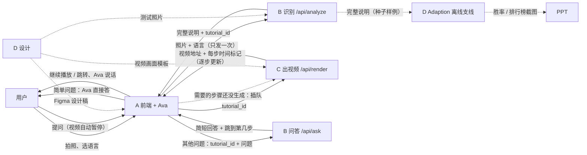

# 家电小老师 HomeGuide：拍一张照片，用母语学会用家电

> Imperial AI Hackathon 2026 · 主赛道 02 Voice, Vision & Generative Media
> 子奖：**fal** + **Anam**　｜　交叉奖：**Adaption**、**Figma**

## 1. 项目简介

在英国，很多人的母语不是英语：国际学生、新移民、移民老人、短期访客。宿舍里的洗衣机、出租屋里的烤箱和暖气调节器，面板上全是英文缩写，很容易用错。

**怎么用：**

1. 打开 App，数字人老师 **Ava** 用你的母语打招呼。
2. 对着家电控制面板拍一张照片。
3. AI 识别品牌、型号和按钮，联网查说明书，写出这台家电的**完整说明**（所有按钮 + 所有步骤）。
4. 生成一段**带步骤标记的母语讲解视频**：在**真实照片上标出要按的按钮**，讲解员**口型同步**，带**双语字幕**。第 1 步做好就开始播，后面的步骤边看边生成。
5. 边看边问：一开口视频就**自动暂停**，Ava 用一两句话回答，然后**继续播放**，或者**跳到相关的那一步**。

**设计原则：照片只识别一次，每一步视频最多生成一次。**

| 顺序 | 做什么 | 谁 | 输入 | 输出 | 每次会话发生几次 |
|---|---|---|---|---|---|
| ① 识别 | 认型号、查说明书、写完整说明 | Claude | 照片 + 语言 | 完整说明 + `tutorial_id` | **1 次** |
| ② 出视频 | 按步骤生成，拼成一整段带时间标记的视频 | fal + ffmpeg | 完整说明 + 照片 | 视频 + 每步时间标记 | **每步最多 1 次** |
| ③ 问答 | 判断问题类型，给简短回答或跳转位置 | Ava / Claude | `tutorial_id` + 问题 | 简短回答 + 跳到第几步 | 每个问题 1 次（很便宜） |

为什么这样设计：

- **不重复识图**：识别完把完整说明存在服务器上，之后提问只传 `tutorial_id`，不再发照片。
- **不重复生成视频**：用户问"怎么快洗"，如果这一步已经生成过，直接**跳到那个时间点**，不重新渲染。
- **不浪费**：视频按观看顺序一步一步生成；用户提问用到还没生成的步骤，就让它**插队**先做；用户离开就**停止生成**，没看到的部分不花钱。
- **问答很便宜**：问答只发一张精简目录给模型，不发讲解词全文和资料链接；简单问题 Ava 自己就能答，连接口都不用调。

**安全设计**

- 标注框用**代码**画在**真实照片**上，不让 AI 凭空生成家电画面，避免标错按钮。
- 每一步都附**资料来源**（官网说明书 / 论坛）；**检查员 AI** 逐步核对，和照片对不上的步骤直接删除。
- **红线**：燃气、电路维修、拆修锅炉等操作不生成教程，只给出官方售后或房东的联系方式。
- 不确定时诚实地说"我不确定"，绝不编造（步骤数据里有 `model_confidence` 字段）。

**Adaption 支线（交叉奖，离线进行）**

主系统里"把英文说明书改写成简单的母语步骤"这件事由 Claude 完成。我们另外用 **Adaption** 把同一件事教给一个**小型开源模型**：用 Adaption 生成训练数据 → 自动微调 → 和原始模型对比打分，把排行榜上的提升作为交叉奖成果。这条支线**不接入现场演示的主流程**，只在 PPT 里展示结果（详见第 7 节）。

---

## 2. 快速开始

```bash
npm install
cp .env.example .env   # 填入 ANTHROPIC_API_KEY 和 ANAM_API_KEY
npm start              # http://localhost:8000
```

- 没有填密钥也能跑：自动进入**演示模式**（示例日文洗衣机面板 + Ava 形象照 + 浏览器朗读），方便先看效果。
- 手机上使用需要 HTTPS（相机 / 麦克风权限）：部署到任意 HTTPS 主机，或本地用 `ngrok http 8000` 之类的隧道。

---

## 3. 每个工具负责什么

| 工具 | 一句话 | 具体负责 | 不负责 |
|---|---|---|---|
| **Anam** | 数字人的**脸和实时对话** | 屏幕上的 Ava；听用户说话、实时回答、口型同步；**调用客户端工具**暂停 / 继续 / 跳转视频、圈按钮；简单问题直接回答 | 不看照片、不写步骤 |
| **ElevenLabs** | **声音**（可选） | 如果 Anam 自带的声音在某种语言上不够自然，就用它替换 | 不是数字人的脸 |
| **Claude** | **大脑** | 看照片、认型号、联网查说明书、写完整说明并翻译；当检查员；判断红线；回答 Ava 答不了的问题并给出跳转位置；给 Ava 的即兴回答补英文字幕 | 不生成图像、视频、声音 |
| **fal** | **生成视频素材**（计划中） | 每一步的母语旁白、讲解员口型同步、照片轻微动画 | 不画标注框（用代码画）；不拼接视频（用 ffmpeg） |
| **ffmpeg** | **拼接视频**（计划中） | 把每一步的片段拼成一整段视频，记录每一步的开始和结束时间；叠加标注和双语字幕 | |
| **Figma** | **界面设计稿** | 手机界面、视频画面模板、二维码贴纸的样式 | 不写代码 |
| **Adaption** | **教一个小模型写母语步骤，冲交叉奖** | 用 **Invent a Dataset** 根据一段任务描述生成"英文家电说明 → 简单母语分步说明"的训练数据；用 **AutoScientist** 同时优化数据和训练设置、自动微调；看微调后模型对比原始模型的胜率和排行榜名次 | **不接入主系统**（平台暂不支持在线调用微调后的模型）；不看照片、不出视频 |

---

## 4. 分工

| 成员 | 角色 | 工具 | 负责的文件 |
|---|---|---|---|
| **A** | 前端 + 数字人 | Anam、ElevenLabs | `public/`、`persona.js`、`languages.js`；视频播放器（步骤标记、暂停 / 继续 / 跳转） |
| **B** | 大脑 | Claude | `server.js` 里的 `/api/analyze`、`/api/ask`、`/api/translate`、提示词 |
| **C** | 视频工厂 | fal、ffmpeg | `/api/render`、`/api/render/:id` 状态查询；按步骤生成和拼接 |
| **D** | 设计 + 交叉奖 + 演示 | Figma、Adaption | `design/`、`docs/`、`adaption/`（训练数据、评测集、结果截图） |

如果只有 3 个人：Figma 归 A，Adaption 和 PPT 归 B。

> B 和 D 的交接点：B 的提示词和 `output/guides/` 里的完整说明，是 D 做 Adaption 数据时的**种子样例和评测参考答案**，B 改提示词后在群里说一声。

---

## 5. 数据流



> 虚线 `B1 → Adaption → PPT` 是离线支线，不影响 A、B、C 的实时流程。

### 谁的数据交给谁

| # | 从 | 交给 | 内容 | 格式 |
|---|---|---|---|---|
| 1 | 用户 | A | 家电照片 + 选的语言 | JPG / PNG |
| 2 | A | B | 照片 + 语言 | 调用 `POST /api/analyze` |
| 3 | B | A | **完整说明** + `tutorial_id` | JSON（见 7.1） |
| 4 | A | C | `tutorial_id` | 调用 `POST /api/render` |
| 5 | C | A | 视频地址 + 每步时间标记，每做好一步更新一次 | JSON（见 7.2），前端轮询 `GET /api/render/:id` |
| 6 | A | B | `tutorial_id` + 问题 + 当前在第几步 | 调用 `POST /api/ask` |
| 7 | B | A | 简短回答 + 要圈的按钮 + 跳到第几步 | JSON（见 7.3） |
| 8 | A | C | 需要优先生成的步骤 | 调用 `POST /api/render`，带 `priority_steps` |
| 9 | B | A | 红线提示：原因 + 官方联系方式 | 完整说明里只有 `warnings`，不进入 4–8 |
| 10 | B | D | 提示词 + 几份完整说明（含 `sources` 里的英文原文片段） | `output/guides/*.json`，D 转成训练样例（见 7.4） |
| 11 | D | PPT | 微调前后对比结果、排行榜名次 | 截图 + `adaption/results.md` |

> 第 6–8 行每个问题走一次，但**不会重新识图，也不会重新生成已有的步骤**。

### 输入用在哪

| 输入 | 用在哪 |
|---|---|
| ① 家电照片 | 识别（只用一次）；视频里画标注 |
| ② 用户选的语言 | 讲解词用这个语言写 + 数字人说话 / 听写语言 |
| ③ 用户对这台家电的疑问 | **不参与识别**；交给 Ava 或 `/api/ask`，决定回答什么、跳到哪一步 |

> **规则：所有人先用样例数据开发，不等别人。** 演示模式的数据在 `demo.js`，可以直接当样例步骤 JSON 用。

---

## 6. 接口

### 6.1 识别：`POST /api/analyze`（B）

- 输入：照片 + `language`。
- 分两段：
  1. Claude 看照片认出**品牌和型号**，用 web search / web fetch 联网查**官网说明书**和**论坛解答**，写研究笔记。
  2. 再看一次照片，把笔记整理成结构化的**完整说明**：每个按钮在照片上的坐标、双语讲解、每步引用的资料来源、小贴士、安全提醒。
- 输出：完整说明（见 7.1），其中带 `tutorial_id`。存到 `output/guides/<tutorial_id>.json`，讲解页可点"下载步骤 JSON"。
- 前端实时显示正在搜索的关键词。
- Claude 请求开启了服务端拒答回退（`fallbacks: "default"`），被安全策略拒绝时会自动换模型重试。

**这是整个会话里唯一一次发送照片给模型。**

### 6.2 出视频：`POST /api/render` 和 `GET /api/render/:tutorial_id`（C）

- 输入：
```json
{ "tutorial_id": "abc123", "priority_steps": [3, 4] }
```
`priority_steps` 可选：用户提问用到还没生成的步骤时，前端传进来让它们插队。

- 做什么：
  1. 从 `output/guides/<tutorial_id>.json` 读完整说明，按步骤顺序排队生成。
  2. 每一步单独生成一个片段（fal 出旁白和口型，代码画标注，ffmpeg 叠字幕）。
  3. 每做好一步，就拼到整段视频末尾，并记下这一步的开始和结束时间。
  4. 已经生成过的步骤**直接跳过**，所以重复调用不会多花钱。
  5. 前端超过一段时间没来查询（用户离开了），就**停止**生成剩下的步骤。
- 输出：视频清单（见 7.2）。前端用 `GET /api/render/:tutorial_id` 轮询，拿到最新的清单。

**来不及的退路：**不拼整段视频，直接返回每一步的小视频列表，播放器按顺序播。跳转、重播一样能做，演示效果差不多。

### 6.3 问答：`POST /api/ask`（B）

**先分流，能不调接口就不调：**

| 问题类型 | 例子 | 谁来答 | 前端怎么做 |
|---|---|---|---|
| 一句话能答 | "这个按钮是干什么的" | **Ava 自己答**（步骤数据已经在她的 system prompt 里），不调接口 | 暂停 → 圈按钮 → Ava 回答 → 继续播放 |
| 要做的事在说明里 | "怎么快洗" | `/api/ask` | 暂停 → Ava 说一句 → 跳到对应步骤播放 |
| 说明里没有 | "能烘干吗"（这台没有烘干） | `/api/ask` | 暂停 → Ava 说"我不确定"并建议查官方 → 继续播放 |

- 输入：
```json
{ "tutorial_id": "abc123", "question": "怎么快洗？", "current_step": 2, "language": "zh" }
```
- 做什么：服务器用 `tutorial_id` 取出完整说明，**只把精简目录发给模型**：每个按钮的名字和作用、每一步的一句话概要。讲解词全文、资料链接都不发，照片也不发。模型判断问题属于哪一类，返回很短的结果。说明里找不到答案时，诚实地说"我不确定"，不编造步骤。
- 输出：见 7.3。

### 6.4 Adaption 支线：微调小模型（D，离线）

**目标**：让一个小型开源模型学会主系统里 Claude 做的那一步——把英文说明书片段改写成**简短、口语化、按步骤编号**的母语说明，并且遇到红线操作时拒绝、给出联系官方的建议。

**步骤：**

1. **写任务描述**（周六 16:15 前定稿）：一段话说明模型要学的行为，例如"输入是一段英文家电说明书原文和目标语言；输出是 3–6 步的简单母语操作步骤，每步一句话，只用说明书里有的信息，不确定就说不确定；涉及燃气、电路、拆修锅炉时不给步骤，只建议联系房东或官方售后"。
2. **生成数据**：把任务描述和 5–10 条种子样例（来自 `demo.js` 和 `output/guides/`）交给 **Invent a Dataset**，生成指令数据（"输入 → 标准答案"成对的样例），格式见 7.4。
3. **检查数据**（D 抽查 30–50 条）：删掉编造按钮、步骤太长、语言不对、红线没拦住的样例。至少 10% 的样例是红线场景、10% 是"说明里没有，应该说不确定"的场景。
4. **留出评测集**：另外准备 30–50 条**不参与训练**的样例（最好来自我们真实拍过的 3 台家电），只用来打分。
5. **微调**：用 **AutoScientist** 选一个小模型做底座，自动调整数据和训练设置，跑完整的微调。
6. **看结果**：记录微调后模型对比原始底座模型的**胜率**，以及排行榜名次；挑 2–3 个前后对比最明显的例子截图。结果写进 `adaption/results.md`，给 PPT 用。

**不做的事**：不把微调后的模型接进 `/api/analyze` 或 `/api/ask`；现场演示全部走 Claude。PPT 里可以说"下一步：用这个小模型替代部分 Claude 调用，降低每台家电的成本"。

---

## 7. 数据格式

### 7.1 完整说明（`/api/analyze` 输出）

```json
{
  "schema": "appliance-tutor/guide@2",
  "tutorial_id": "abc123",
  "brand": "Panasonic",
  "model": "NA-F70PB15",
  "model_confidence": "high",
  "language": "zh",
  "appliance_native": "全自动洗衣机",
  "appliance_en": "Washing machine",
  "buttons": [
    { "id": "b1", "panel_text": "電源", "name_native": "电源键", "function_native": "…",
      "box": { "x": 40, "y": 400, "w": 90, "h": 150 } }
  ],
  "steps": [
    { "step": 1, "button_id": "b1", "action_native": "按电源键",
      "narration_native": "…", "narration_en": "…", "sources": ["https://…"] }
  ],
  "tips":     [{ "native": "…", "en": "…" }],
  "warnings": [{ "native": "…", "en": "…" }],
  "sources":  [{ "id": 1, "title": "…取扱説明書", "url": "https://…", "kind": "web", "cited": true }]
}
```

| 字段 | 说明 |
|---|---|
| `tutorial_id` | 这份教程的编号，之后视频和问答都靠它取上下文 |
| `model_confidence` | 型号识别把握：`high` / `medium` / `low`，低时 Ava 要说"我不确定" |
| `buttons[].box` | 按钮在照片上的位置：左上角 `x`、`y`，宽 `w`、高 `h`，单位是像素 |
| `buttons[].panel_text` | 面板上印的原文 |
| `steps[].button_id` | 这一步要按哪个按钮，对应 `buttons[].id` |
| `steps[].action_native` | 一句话概要，`/api/ask` 的精简目录就用它 |
| `steps[].narration_native` / `narration_en` | 讲解员念的母语讲解词 / 英文字幕 |
| `steps[].sources` | 这一步依据的资料链接 |
| `warnings` | 安全提醒；越过红线时不生成步骤，只给原因和官方联系方式 |

### 7.2 视频清单（`/api/render` 输出）

```json
{
  "tutorial_id": "abc123",
  "status": "rendering",
  "video_url": "/media/abc123_full.mp4",
  "chapters": [
    { "step": 1, "start": 0.0,  "end": 12.4, "ready": true },
    { "step": 2, "start": 12.4, "end": 25.1, "ready": true },
    { "step": 3, "ready": false },
    { "step": 4, "ready": false }
  ],
  "clips": [
    { "step": 1, "url": "/media/abc123_step1.mp4" },
    { "step": 2, "url": "/media/abc123_step2.mp4" }
  ]
}
```

| 字段 | 说明 |
|---|---|
| `status` | `rendering` 还在生成 / `done` 全部做完 / `stopped` 用户离开后停止 |
| `video_url` | 目前已经拼好的整段视频 |
| `chapters[].start` / `end` | 这一步在整段视频里的开始和结束时间（秒），播放器用来画步骤标记、跳转、重播 |
| `chapters[].ready` | 这一步做好没有；没做好时前端显示"正在准备"，Ava 先陪聊 |
| `clips` | 每一步的单独小视频（退路方案用） |

视频按"**家电型号 + 步骤 + 语言**"存储，同一台洗衣机换个用户、换个问题都能直接复用。

### 7.3 问答结果（`/api/ask` 输出）

```json
{
  "type": "jump",
  "answer_native": "快洗用 Quick 15，我带你看第 4 步。",
  "answer_en": "Use Quick 15 — let me take you to step 4.",
  "highlight_button": "b6",
  "jump_to_step": 4,
  "resume": false
}
```

| 字段 | 说明 |
|---|---|
| `type` | `answer_only`：只回答 / `jump`：回答后跳到某一步 / `unsure`：说明里没有 |
| `answer_native` / `answer_en` | 一两句话的简短回答，Ava 念母语，字幕显示英文 |
| `highlight_button` | 要在照片上圈出的按钮（可选） |
| `jump_to_step` | `type = jump` 时跳到第几步；如果这一步还没生成，前端调 `/api/render` 让它插队 |
| `resume` | `true`：回答完从暂停处继续播放 |

**改格式之前必须先在群里说**，因为 A、B、C 都依赖它。

### 7.4 Adaption 训练样例（`adaption/train.jsonl`、`adaption/eval.jsonl`）

每行一条"输入 → 标准答案"：

```json
{
  "prompt": "Target language: zh\nAppliance: washing machine (Panasonic NA-F70PB15)\nManual excerpt: \"Press POWER. Select WOOL with the COURSE button. Press START/PAUSE.\"\nTask: Write simple numbered steps in the target language.",
  "completion": "1. 按电源键开机。\n2. 按“程序”键，选到“羊毛”。\n3. 按“开始/暂停”键开始洗。"
}
```

红线样例的标准答案只写原因和建议，例如：`"这一步涉及燃气，不建议自己操作。请联系房东或品牌官方售后。"`

| 文件 | 内容 | 条数（建议） |
|---|---|---|
| `train.jsonl` | Invent a Dataset 生成并经过 D 抽查的训练样例 | 几百到几千条 |
| `eval.jsonl` | 留出的评测样例，**不参与训练** | 30–50 条 |
| `results.md` | 底座模型、胜率、排行榜名次、前后对比例子 | — |

---

## 8. 数字人 Ava

已在 Anam 账号里创建保存版 persona **"Ava – Appliance Tutor"**，可以在 Anam Lab 里直接预览。

| | ID | 说明 |
|---|---|---|
| Persona | `f18ab547-696d-4787-aab3-9cc1f7644599` | Anam Lab 里的保存版 |
| 形象 Avatar | `edf6fdcb-acab-44b8-b974-ded72665ee26` | Mia – studio（写实真人），渲染模型 `cara-4`（口型同步） |
| 声音 Voice | `90313ddc-4fc0-11f1-84b0-52bacf74fa75` | Amanda – Warm Guide，美式英语（Cartesia sonic-3.6） |
| 模型 LLM | `65421f1c-c7de-4bc4-ac27-d171c16ef41f` | Qwen 3.8 27B（Anam 托管，低延迟、支持工具调用） |

都定义在 `persona.js`。选英语时用 Ava 的英文声音；选其他母语时换成该语言的女声，形象和模型不变。

**两段会话：**

- **greet**：Ava 用 `initialMessage` 打招呼，陪用户拍照。
- **lesson**：识别完成后重连，把完整说明写进 system prompt，并给 Ava 客户端工具：`next_step` / `previous_step` / `repeat_step` / `go_to_step` / `highlight_button`，以及视频控制 `pause_video` / `resume_video`。
  - 用户说"下一步""再说一遍"：Ava 调工具，播放器按步骤标记跳转或重播，**不重新生成**。
  - 用户一开口提问：先 `pause_video`；简单问题 Ava 自己答（必要时 `highlight_button`），答完 `resume_video`；答不了的转给 `/api/ask`，按返回结果跳转或继续。

（Anam 不能在会话中途改 system prompt，所以讲解阶段要重新连接一次，大约 1 秒。）

| 其他功能 | 实现 |
|---|---|
| 照片标注 | 当前步骤的按钮用橙色脉冲圈 + 步骤号；Ava 讲解时指向的按钮用粉色；数字人画中画自动躲开按钮 |
| 双语字幕 | 讲解词：母语逐字点亮 + 英文；Ava 的即兴回答：说完后由 Claude 补一行英文 |
| 步骤标记 | 播放器进度条上按 `chapters` 画出每一步，点一下就跳过去 |
| 讲解视频导出 | 右上角 ● 录制，把照片、标注、数字人、字幕和声音合成为 MP4 / WebM |

---

## 9. 文件结构

```
.
├── README.md
├── .env.example        # API key 模板（不含真实 key）
├── server.js           # /api/analyze、/api/ask、/api/render、/api/session-token、/api/translate
├── persona.js          # Ava 的形象 / 声音 / 模型 ID、提示词、客户端工具
├── languages.js        # 10 种母语，每种配一个 Anam 母语声音 + 界面文案
├── demo.js             # 演示模式数据（也是样例步骤 JSON）
├── public/             # 前端（无构建步骤），含 demo-panel.svg
├── output/guides/      # 完整说明，文件名是 tutorial_id
├── output/media/       # 每一步的视频片段和拼好的整段视频
├── design/             # D：Figma 链接、截图
├── adaption/           # D：任务描述、train.jsonl、eval.jsonl、results.md、排行榜截图
└── docs/               # D：演示脚本、PPT
```

支持的语言：中文、English、Español、Tiếng Việt、日本語、한국어、Français、العربية、हिन्दी、Português。加语言照着 `languages.js` 抄一项即可。

---

## 10. API key 与可调项

| 变量 | 说明 |
|---|---|
| `ANTHROPIC_API_KEY` | 必填（不填进入演示模式） |
| `ANAM_API_KEY` | 必填（不填进入演示模式） |
| `FAL_KEY` | 做 fal 视频时需要 |
| `ELEVENLABS_API_KEY` | 可选 |
| `ADAPTION_API_KEY` | 只有 D 做 Adaption 支线时需要；主系统不读它，不填也不影响演示 |
| `ANAM_AVATAR_ID` / `ANAM_LLM_ID` | 换数字人形象 / Ava 的对话模型 |
| `CLAUDE_MODEL` | 换 Claude 模型 |
| `PORT` | 端口，默认 8000 |

**多个密钥自动轮换：** 同一个服务可以放多个密钥（`NAME`、`NAME_2`、`NAME_3` …，见 `.env.example`）。先用第一个，额度不足 / 鉴权失败 / 被限流时自动换下一个。JavaScript 用 `keys.js`（`withKey` / `fetchWithKey`），Python 用 `keyring.py`（`KeyRing`）；Claude、Anam、fal 已经接上，新接的服务（ElevenLabs、Adaption）也请走这两个文件。

**自动改代码的智能体：** `npm run agent -- --prompt AGENT_PROMPT.md --branch tonight-demo` 会在项目旁边另建一个工作区，让 Claude 按任务文件在那个分支上干活。一个 Claude 账户的额度用完时自动换下一个密钥，并接着同一段对话继续；中断后重新运行同一条命令会接着做。它不会 push、不会改 `.env`，默认最多花 40 美元（`--max-usd`）。用法见 `tools/run_agent.mjs` 开头，或 `npm run agent -- --help`。

⚠️ **`.env` 已写入 `.gitignore`，绝对不要把真实的 key 提交到 GitHub。** 仓库一旦公开，key 会被别人盗用，额度很快被刷光。

---

## 11. 时间表与同步点

| 时间 | A 前端 + 数字人 | B 大脑 | C 视频工厂 | D 设计 + 交叉奖 |
|---|---|---|---|---|
| **周六 15:50–16:15** | 注册 Anam，跑通官方示例 | 手写样例步骤数据 | 注册 fal；问 fal 的智能体该用哪些模型 | 拍 3 台家电照片；写 Adaption 任务描述 + 5–10 条种子样例，启动 Invent a Dataset |
| 🚩 **16:15 同步** | 样例数据、照片、API key 全部就位 | | | |
| **16:15–20:00** | 网页 + Ava 说中文；定义工具 | 照片 → 完整说明；测按钮位置准不准 | 样例数据 → 每步视频片段 | Figma 设计稿 17:00 前交出；抽查 Adaption 数据（删坏样例、补红线和"不确定"样例）；准备评测集 |
| 🚩 **20:00 同步** | A 页面能交互，B 能处理真实照片，C 能出每步视频 | | | |
| **20:00–23:00** | **优先 ③**：提问自动暂停 → Ava 简短回答 → 继续播放 | **优先 ②**：`/api/ask` 用 `tutorial_id` 取上下文、只发精简目录；检查员 + 安全红线 | **优先 ①**：拼成整段视频 + 步骤时间标记；已生成的步骤跳过 | 用 AutoScientist 启动微调（跑一整夜）；PPT 初稿；当测试用户 |
| 🚩 **23:00 同步** | **端到端跑通，粗糙也行** | | | |
| **周日 9:00–12:00** | 步骤标记跳转 / 重播；等待时陪聊；套用设计 | 问答打磨；加第二种语言 | 第二种语言的语音和口型；双语字幕 | 看胜率和排行榜，截图前后对比例子，写 `adaption/results.md`；二维码页面；PPT 定稿 |
| 🚩 **12:00 同步** | **功能冻结，录备用演示视频** | | | |
| **周日下午** | 现场操作 | 准备技术问答 | 只修 bug | 主讲 |

**今晚的三个优先项（建议按 ② → ③ → ① 的顺序完成）**

| 编号 | 内容 | 负责 | 为什么排这个顺序 |
|---|---|---|---|
| ② | `/api/ask` 用 `tutorial_id` 取上下文，只发相关信息 | B | 改动最小，A 的暂停逻辑依赖它的返回格式 |
| ③ | 提问自动暂停 → 简短语音回答 → 继续播放 | A | 接上 ② 就能演示多轮问答 |
| ① | 整段视频 + 步骤时间标记，跳转和重播不用重新渲染 | C | 工作量最大；来不及就用"每步小视频 + 播放列表"的退路 |

这三项做完，多轮问答就顺畅了，也避开了两类开销：重复识图、重复生成视频。

**周日上午的优先级**

1. 演示路线稳定：同一条路线跑 5 到 10 遍不出错；处理慢和失败的情况。**演示用的那台洗衣机，视频提前全部生成好。**
2. 亮点：边看边问、第二种语言、红线演示、视频画面。
3. 有时间才做：边看边生成 + 提问步骤插队、用户离开就停止生成、二维码、整体美化。

Adaption 支线和上面三级**互不抢人**：微调在后台跑，D 只需要周日上午收结果、截图。如果周日 11:00 还没有结果，PPT 就展示数据集和评测方法，说明"微调进行中"。

如果周六晚上没跑通，周日上午**只做串联**，第 3 级全部砍掉。

---

## 12. 三分钟演示脚本

1. **（30 秒）痛点**：刚到伦敦的留学生第一次用宿舍洗衣机，面板全是英文缩写，把毛衣洗缩了。
2. **（90 秒）现场演示**：拍照 → Ava 用中文说"稍等，我在查说明书"，屏幕上显示正在搜的关键词 → 讲解视频开始播放：照片上标出按钮，讲解员用中文讲解，带双语字幕，进度条上有步骤标记 → 用户问"这个按钮是干什么的"，视频自动暂停，Ava 圈出按钮回答一句，视频继续 → 用户问"羊毛衣服怎么洗"，Ava 回答一句，视频直接跳到对应步骤。
3. **（30 秒）换人换语言**：同一台洗衣机切换成另一种语言；再展示一张燃气锅炉照片被红线拦截。
4. **（30 秒）商业模式与技术**：照片只识别一次、每一步视频只生成一次，同一台洗衣机的视频所有租客共用；宿舍和房东用二维码贴纸；每个赞助商工具用在哪里；Adaption：一页 PPT 展示"用 Adaption 生成数据 → 微调小模型 → 胜率提升多少 / 排行榜第几"，加一个前后对比例子，并说明下一步可以用这个小模型降低成本。
