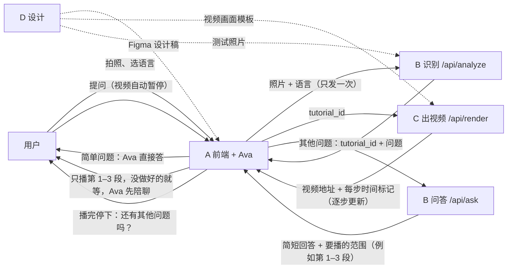
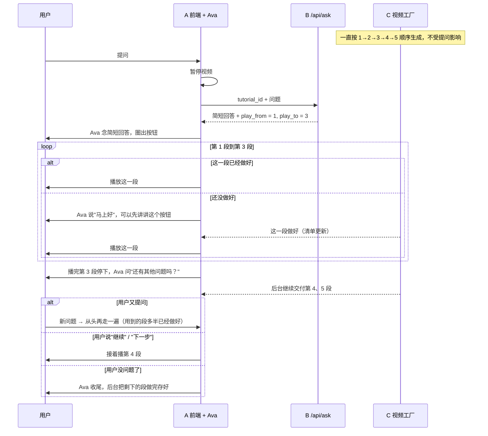

# 家电小老师 HomeGuide：拍一张照片，用母语学会用家电

> Imperial AI Hackathon 2026 · 主赛道 02 Voice, Vision & Generative Media
> 子奖：**fal** + **Anam**　｜　交叉奖：**Adaption**、**Figma**

## 1. 项目简介

在英国，很多人的母语不是英语：国际学生、新移民、移民老人、短期访客。宿舍里的洗衣机、出租屋里的烤箱和暖气调节器，面板上全是英文缩写，很容易用错。

**怎么用：**

1. 打开 App，数字人老师 **Ava** 用你的母语打招呼。
2. 对着家电控制面板拍一张照片。
3. AI 识别品牌、型号和按钮，联网查说明书，写出这台家电的**完整说明**（所有按钮 + 所有步骤）。
4. 生成一段**带步骤标记的母语讲解视频**：在**真实照片上标出要按的按钮**，讲解员**口型同步**，带**双语字幕**。第 1 步做好就开始播，后面的步骤边看边生成。
5. 边看边问：一开口视频就**自动暂停**，Ava 用一两句话回答，然后**继续播放**，或者**跳到相关的那一步**。

**设计原则：照片只识别一次，每一步视频最多生成一次。**

| 顺序 | 做什么 | 谁 | 输入 | 输出 | 每次会话发生几次 |
|---|---|---|---|---|---|
| ① 识别 | 认型号、查说明书、写完整说明 | Claude | 照片 + 语言 | 完整说明 + `tutorial_id` | **1 次** |
| ② 出视频 | 按步骤生成，拼成一整段带时间标记的视频 | fal + ffmpeg | 完整说明 + 照片 | 视频 + 每步时间标记 | **每步最多 1 次** |
| ③ 问答 | 判断问题类型，给简短回答或跳转位置 | Ava / Claude | `tutorial_id` + 问题 | 简短回答 + 跳到第几步 | 每个问题 1 次（很便宜） |

为什么这样设计：

- **不重复识图**：识别完把完整说明存在服务器上，之后提问只传 `tutorial_id`，不再发照片。
- **不重复生成视频**：用户问"怎么快洗"，如果这一步已经生成过，直接**跳到那个时间点**，不重新渲染。
- **不浪费**：视频**严格按顺序**一段一段生成（1 → 2 → 3 …），做好一段就交给前端一段；用户离开就**停止生成**，没看到的部分不花钱。
- **一个问题只播它需要的那几段**：比如一共 5 段，用户的问题只需要前 3 段。A 就只播第 1–3 段（哪一段还没做好就等一下，Ava 先陪聊），**播完第 3 段就停下**，Ava 问"还有其他问题吗？"。这时 C **不停**，在后台继续生成第 4、5 段，下一个问题用到时多半已经做好了。
- **问答很便宜**：问答只发一张精简目录给模型，不发讲解词全文和资料链接；简单问题 Ava 自己就能答，连接口都不用调。

**安全设计**

- 标注框用**代码**画在**真实照片**上，不让 AI 凭空生成家电画面，避免标错按钮。
- 每一步都附**资料来源**（官网说明书 / 论坛）；**检查员 AI** 逐步核对，和照片对不上的步骤直接删除。
- **红线**：燃气、电路维修、拆修锅炉等操作不生成教程，只给出官方售后或房东的联系方式。
- 不确定时诚实地说"我不确定"，绝不编造（步骤数据里有 `model_confidence` 字段）。

---

## 2. 快速开始

```bash
npm install
cp .env.example .env   # 填入 ANTHROPIC_API_KEY 和 ANAM_API_KEY
npm start              # http://localhost:8000
```

- 没有填密钥也能跑：自动进入**演示模式**（示例日文洗衣机面板 + Ava 形象照 + 浏览器朗读），方便先看效果。
- 手机上使用需要 HTTPS（相机 / 麦克风权限）：部署到任意 HTTPS 主机，或本地用 `ngrok http 8000` 之类的隧道。

---

## 3. 每个工具负责什么

| 工具 | 一句话 | 具体负责 | 不负责 |
|---|---|---|---|
| **Anam** | 数字人的**脸和实时对话** | 屏幕上的 Ava；听用户说话、实时回答、口型同步；**调用客户端工具**暂停 / 继续 / 跳转视频、圈按钮；简单问题直接回答 | 不看照片、不写步骤 |
| **ElevenLabs** | **声音**（可选） | 如果 Anam 自带的声音在某种语言上不够自然，就用它替换 | 不是数字人的脸 |
| **Claude** | **大脑** | 看照片、认型号、联网查说明书、写完整说明并翻译；当检查员；判断红线；回答 Ava 答不了的问题并给出跳转位置；给 Ava 的即兴回答补英文字幕 | 不生成图像、视频、声音 |
| **fal** | **生成视频素材**（计划中） | 每一步的母语旁白、讲解员口型同步、照片轻微动画 | 不画标注框（用代码画）；不拼接视频（用 ffmpeg） |
| **ffmpeg** | **拼接视频**（计划中） | 把每一步的片段拼成一整段视频，记录每一步的开始和结束时间；叠加标注和双语字幕 | |
| **Figma** | **界面设计稿** | 手机界面、视频画面模板、二维码贴纸的样式 | 不写代码 |
| **Adaption** | **微调一个小模型，冲交叉奖** | 生成"英文家电说明 → 简单母语分步说明"的数据，微调小模型，看排行榜提升 | **不接入主系统**（平台暂不支持在线调用微调后的模型） |

---

## 4. 分工

| 成员 | 角色 | 工具 | 负责的文件 |
|---|---|---|---|
| **A** | 前端 + 数字人 | Anam、ElevenLabs | `public/`、`persona.js`、`languages.js`；视频播放器（步骤标记、暂停 / 继续 / 跳转） |
| **B** | 大脑 | Claude | `server.js` 里的 `/api/analyze`、`/api/ask`、`/api/translate`、提示词 |
| **C** | 视频工厂 | fal、ffmpeg | `/api/render`、`/api/render/:id` 状态查询；按步骤生成和拼接 |
| **D** | 设计 + 交叉奖 + 演示 | Figma、Adaption | `design/`、`docs/` |

如果只有 3 个人：Figma 归 A，Adaption 和 PPT 归 B。

---

## 5. 数据流



### 谁的数据交给谁

| # | 从 | 交给 | 内容 | 格式 |
|---|---|---|---|---|
| 1 | 用户 | A | 家电照片 + 选的语言 | JPG / PNG |
| 2 | A | B | 照片 + 语言 | 调用 `POST /api/analyze` |
| 3 | B | A | **完整说明** + `tutorial_id` | JSON（见 7.1） |
| 4 | A | C | `tutorial_id` | 调用 `POST /api/render` |
| 5 | C | A | **按顺序一段一段交付**：每做好一段，清单里就多一段和它的时间标记 | JSON（见 7.2），前端轮询 `GET /api/render/:id` |
| 6 | A | B | `tutorial_id` + 问题 + 当前在第几步 | 调用 `POST /api/ask` |
| 7 | B | A | 简短回答 + 要圈的按钮 + **要播的范围**（从第几段到第几段，例如 1–3） | JSON（见 7.3） |
| 8 | B | A | 红线提示：原因 + 官方联系方式 | 完整说明里只有 `warnings`，不进入 4–7 |

> 第 6–7 行每个问题走一次，但**不会重新识图，也不会重新生成已有的段**。C 不受提问影响，一直按顺序往下做。

### 提问时 A 怎么处理（以"一共 5 段，问题只需要前 3 段"为例）



规则：

1. **一个问题只播它需要的范围**：从 `play_from` 播到 `play_to`，播完就停，不自动往下播。
2. 判断第 N 段好没好，只看清单里 `chapters[N-1].ready`；没做好就等，等待时间用 Ava 的简短回答和陪聊填上。
3. **C 不因为提问改顺序，也不因为提问停下**，一直在后台按顺序往下做，这样下一个问题来时用到的段多半已经做好。
4. 播完一个范围后，由 Ava 问"还有其他问题吗？"，根据用户的回答决定：再答一个问题、继续往下播、还是结束。
5. 用户关掉页面才停止生成（见 6.2）。

### 输入用在哪

| 输入 | 用在哪 |
|---|---|
| ① 家电照片 | 识别（只用一次）；视频里画标注 |
| ② 用户选的语言 | 讲解词用这个语言写 + 数字人说话 / 听写语言 |
| ③ 用户对这台家电的疑问 | **不参与识别**；交给 Ava 或 `/api/ask`，决定回答什么、跳到哪一步 |

> **规则：所有人先用样例数据开发，不等别人。** 演示模式的数据在 `demo.js`，可以直接当样例步骤 JSON 用。

---

## 6. 接口

### 6.1 识别：`POST /api/analyze`（B）

- 输入：照片 + `language`。
- 分两段：
  1. Claude 看照片认出**品牌和型号**，用 web search / web fetch 联网查**官网说明书**和**论坛解答**，写研究笔记。
  2. 再看一次照片，把笔记整理成结构化的**完整说明**：每个按钮在照片上的坐标、双语讲解、每步引用的资料来源、小贴士、安全提醒。
- 输出：完整说明（见 7.1），其中带 `tutorial_id`。存到 `output/guides/<tutorial_id>.json`，讲解页可点"下载步骤 JSON"。
- 前端实时显示正在搜索的关键词。
- Claude 请求开启了服务端拒答回退（`fallbacks: "default"`），被安全策略拒绝时会自动换模型重试。

**这是整个会话里唯一一次发送照片给模型。**

### 6.2 出视频：`POST /api/render` 和 `GET /api/render/:tutorial_id`（C）

- 输入：
```json
{ "tutorial_id": "abc123" }
```

- 做什么：
  1. 从 `output/guides/<tutorial_id>.json` 读完整说明，**严格按步骤顺序**一段一段生成（1 → 2 → 3 …），不因为提问改变顺序。
  2. 每一步单独生成一个片段（fal 出旁白和口型，代码画标注，ffmpeg 叠字幕）。
  3. 每做好一段，就马上加到清单里交给前端，拼到整段视频末尾，并记下这一段的开始和结束时间。
  4. 已经生成过的步骤**直接跳过**，所以重复调用不会多花钱。
  5. 前端超过一段时间没来查询（用户离开了），就**停止**生成剩下的步骤。
- 输出：视频清单（见 7.2）。前端用 `GET /api/render/:tutorial_id` 轮询，拿到最新的清单。

**来不及的退路：**不拼整段视频，直接返回每一步的小视频列表，播放器按顺序播。跳转、重播一样能做，演示效果差不多。

### 6.3 问答：`POST /api/ask`（B）

**先分流，能不调接口就不调：**

| 问题类型 | 例子 | 谁来答 | 前端怎么做 |
|---|---|---|---|
| 一句话能答 | "这个按钮是干什么的" | **Ava 自己答**（步骤数据已经在她的 system prompt 里），不调接口 | 暂停 → 圈按钮 → Ava 回答 → 继续播放 |
| 要做的事在说明里 | "羊毛衣服怎么洗" | `/api/ask` | 暂停 → Ava 说一句 → 只播需要的那几段（例如第 1–3 段）→ 停下问"还有其他问题吗？" |
| 说明里没有 | "能烘干吗"（这台没有烘干） | `/api/ask` | 暂停 → Ava 说"我不确定"并建议查官方 → 继续播放 |

- 输入：
```json
{ "tutorial_id": "abc123", "question": "怎么快洗？", "current_step": 2, "language": "zh" }
```
- 做什么：服务器用 `tutorial_id` 取出完整说明，**只把精简目录发给模型**：每个按钮的名字和作用、每一步的一句话概要。讲解词全文、资料链接都不发，照片也不发。模型判断问题属于哪一类，返回很短的结果。说明里找不到答案时，诚实地说"我不确定"，不编造步骤。
- 输出：见 7.3。

**处理顺序（`details_instruction` 分支已实现）：**

1. **先过安全红线**（`safety.js`）：设备本身被拦截，或问题涉及维修、拆机、燃气、电路、冒烟起火 → **不交给模型、不直接回答**，返回固定的多语言话术：建议联系厂家官方售后或房东（燃气再加紧急电话）。
2. **再判断问题类型**（`brain.js`，没有 Claude 时用本地规则）：

| `intent` | 用户的情况 | 前端怎么做 |
|---|---|---|
| `how_to_use` | 不会用这台家电 | 播放**完整讲解**（`play_from = 1`，`play_to = 最后一步`） |
| `label` | 看不懂面板上的字 / 图标 | **放大**照片上的那个按钮（`zoom = true`），显示"原文 ＝ 母语名称"，答完继续播放 |
| `function` | 不懂某一个功能 | **只播讲这个功能的那几步**（剪已有的章节，`clip` 给出时间范围），**不生成新视频**；没有哪一步讲过它就退回 `label` |
| `other` / `unsure` | 一句话能答 / 说明里没有 | 简短回答（或说"我不确定"），继续播放 |
| `danger` | 越过红线 | 显示安全提醒，停在原地 |

**照片也先过红线**：`/api/analyze` 的第 0 步先判断设备本身（燃气设备、配电箱、被拆开的机器等），越线就不检索、不生成步骤，完整说明里 `safety = "blocked"`，只有 `safety_message_*`、`contact` 和 `warnings`。红线清单在 `safety.js` 的 `TRIAGE_SYSTEM`。

**步骤时间标记**：`GET /api/render/:tutorial_id` 现在就能用。C 的真实清单（`output/media/<tutorial_id>.json`）出来前，时间按讲解词长度估算；播放器用它画步骤标记、跳转、重播，都不重新渲染。

---

## 7. 数据格式

### 7.1 完整说明（`/api/analyze` 输出）

```json
{
  "schema": "appliance-tutor/guide@2",
  "tutorial_id": "abc123",
  "brand": "Panasonic",
  "model": "NA-F70PB15",
  "model_confidence": "high",
  "language": "zh",
  "appliance_native": "全自动洗衣机",
  "appliance_en": "Washing machine",
  "buttons": [
    { "id": "b1", "panel_text": "電源", "name_native": "电源键", "function_native": "…",
      "box": { "x": 40, "y": 400, "w": 90, "h": 150 } }
  ],
  "steps": [
    { "step": 1, "button_id": "b1", "action_native": "按电源键",
      "narration_native": "…", "narration_en": "…", "sources": ["https://…"] }
  ],
  "tips":     [{ "native": "…", "en": "…" }],
  "warnings": [{ "native": "…", "en": "…" }],
  "sources":  [{ "id": 1, "title": "…取扱説明書", "url": "https://…", "kind": "web", "cited": true }]
}
```

| 字段 | 说明 |
|---|---|
| `tutorial_id` | 这份教程的编号，之后视频和问答都靠它取上下文 |
| `model_confidence` | 型号识别把握：`high` / `medium` / `low`，低时 Ava 要说"我不确定" |
| `buttons[].box` | 按钮在照片上的位置：左上角 `x`、`y`，宽 `w`、高 `h`，单位是像素 |
| `buttons[].panel_text` | 面板上印的原文 |
| `steps[].button_id` | 这一步要按哪个按钮，对应 `buttons[].id` |
| `steps[].action_native` | 一句话概要，`/api/ask` 的精简目录就用它 |
| `steps[].narration_native` / `narration_en` | 讲解员念的母语讲解词 / 英文字幕 |
| `steps[].sources` | 这一步依据的资料链接 |
| `warnings` | 安全提醒；越过红线时不生成步骤，只给原因和官方联系方式 |

### 7.2 视频清单（`/api/render` 输出）

```json
{
  "tutorial_id": "abc123",
  "status": "rendering",
  "video_url": "/media/abc123_full.mp4",
  "chapters": [
    { "step": 1, "start": 0.0,  "end": 12.4, "ready": true },
    { "step": 2, "start": 12.4, "end": 25.1, "ready": true },
    { "step": 3, "ready": false },
    { "step": 4, "ready": false }
  ],
  "clips": [
    { "step": 1, "url": "/media/abc123_step1.mp4" },
    { "step": 2, "url": "/media/abc123_step2.mp4" }
  ]
}
```

| 字段 | 说明 |
|---|---|
| `status` | `rendering` 还在生成 / `done` 全部做完 / `stopped` 用户离开后停止 |
| `video_url` | 目前已经拼好的整段视频 |
| `chapters[].start` / `end` | 这一步在整段视频里的开始和结束时间（秒），播放器用来画步骤标记、跳转、重播 |
| `chapters[].ready` | 这一段做好没有。因为按顺序生成，`ready` 一定是前面连续几段为 `true`、后面全是 `false`；A 要跳到第 N 段时就等到它变成 `true`，期间 Ava 先陪聊 |
| `clips` | 每一步的单独小视频（退路方案用） |

视频按"**家电型号 + 步骤 + 语言**"存储，同一台洗衣机换个用户、换个问题都能直接复用。

### 7.3 问答结果（`/api/ask` 输出）

```json
{
  "type": "play",
  "answer_native": "羊毛衣服用 Wool 模式，跟着我做前三步就好。",
  "answer_en": "Use the Wool program — just follow the first three steps.",
  "highlight_button": "b4",
  "play_from": 1,
  "play_to": 3,
  "resume": false
}
```

| 字段 | 说明 |
|---|---|
| `type` | `answer_only`：只回答 / `play`：回答后播放某几段 / `unsure`：说明里没有 |
| `answer_native` / `answer_en` | 一两句话的简短回答，Ava 念母语，字幕显示英文 |
| `highlight_button` | 要在照片上圈出的按钮（可选） |
| `play_from` / `play_to` | `type = play` 时要播的范围：从第几段播到第几段，播完就停。只需要一段时两个数字相同。某一段还没做好时，A 等 C 按顺序做到再播（见第 5 节"提问时 A 怎么处理"） |
| `resume` | `true`：回答完从暂停处继续播放（`answer_only` 时用） |

`details_instruction` 分支在上面的基础上**只加字段，不改已有字段**：

| 新字段 | 说明 |
|---|---|
| `intent` | `how_to_use` / `label` / `function` / `other` / `unsure` / `danger`（见 6.3） |
| `zoom` | `true`：放大 `highlight_button` 指的按钮 |
| `clip` | `type = play` 时，要播的范围在整段视频里的 `{ start, end }`（秒） |
| `type = "danger"` | 新增的取值：红线拒答，`answer_*` 是固定的安全话术 |

**改格式之前必须先在群里说**，因为 A、B、C 都依赖它。

---

## 8. 数字人 Ava

已在 Anam 账号里创建保存版 persona **"Ava – Appliance Tutor"**，可以在 Anam Lab 里直接预览。

| | ID | 说明 |
|---|---|---|
| Persona | `f18ab547-696d-4787-aab3-9cc1f7644599` | Anam Lab 里的保存版 |
| 形象 Avatar | `edf6fdcb-acab-44b8-b974-ded72665ee26` | Mia – studio（写实真人），渲染模型 `cara-4`（口型同步） |
| 声音 Voice | `90313ddc-4fc0-11f1-84b0-52bacf74fa75` | Amanda – Warm Guide，美式英语（Cartesia sonic-3.6） |
| 模型 LLM | `65421f1c-c7de-4bc4-ac27-d171c16ef41f` | Qwen 3.8 27B（Anam 托管，低延迟、支持工具调用） |

都定义在 `persona.js`。选英语时用 Ava 的英文声音；选其他母语时换成该语言的女声，形象和模型不变。

**两段会话：**

- **greet**：Ava 用 `initialMessage` 打招呼，陪用户拍照。
- **lesson**：识别完成后重连，把完整说明写进 system prompt，并给 Ava 客户端工具：`next_step` / `previous_step` / `repeat_step` / `go_to_step` / `highlight_button`，以及视频控制 `pause_video` / `resume_video`。
  - 用户说"下一步""再说一遍"：Ava 调工具，播放器按步骤标记跳转或重播，**不重新生成**。
  - 用户一开口提问：先 `pause_video`；简单问题 Ava 自己答（必要时 `highlight_button`），答完 `resume_video`；答不了的转给 `/api/ask`，按返回结果跳转或继续。
  - 要播的段还没做好：Ava 先说"马上好"，可以顺便讲讲这个按钮，等这一段做好再播。
  - 播完这个问题需要的范围就停下，Ava 问"还有其他问题吗？"；用户说"继续"就接着往下播，说新问题就再走一遍问答。

（Anam 不能在会话中途改 system prompt，所以讲解阶段要重新连接一次，大约 1 秒。）

**会话时长（`video_section` 分支）：** Anam 每个会话有时长上限（Free 套餐 3 分钟，和账户总分钟数是两回事）。前端这样避开它：

- **按段续会话**：讲解每一步是一段。开始一段之前，如果当前会话剩下的时间不够讲完这一段，就先开一个新会话（约 1 秒），再接着讲。`ensureSession()` 在 `public/app.js`。
- **说完就断开**：Ava 说完后几秒没人接话，就主动断开会话进入待机（💤，不占分钟数）。
- **有输入再连上**：用户点按钮、点步骤标记、打字，或者说话（待机时用浏览器自带的语音识别听），就开新会话继续。
- 会话中途被 Anam 断开（到了上限）时，自动开新会话把这一段重讲一遍。
- 可调项：`ANAM_SESSION_LIMIT_SECONDS`（默认 180，套餐升级后改大）、`ANAM_IDLE_SECONDS`（默认 4）、`LESSON_PAUSE_EACH_SECTION=1`（每讲完一段就停下等用户）。
- 新会话不记得之前的口头对话，但讲到第几步、完整说明都还在。

| 其他功能 | 实现 |
|---|---|
| 照片标注 | 当前步骤的按钮用橙色脉冲圈 + 步骤号；Ava 讲解时指向的按钮用粉色；数字人画中画自动躲开按钮 |
| 双语字幕 | 讲解词：母语逐字点亮 + 英文；Ava 的即兴回答：说完后由 Claude 补一行英文 |
| 步骤标记 | 播放器进度条上按 `chapters` 画出每一步，点一下就跳过去 |
| 讲解视频导出 | 右上角 ● 录制，把照片、标注、数字人、字幕和声音合成为 MP4 / WebM |

---

## 9. 文件结构

```
.
├── README.md
├── .env.example        # API key 模板（不含真实 key）
├── server.js           # /api/analyze、/api/ask、/api/render、/api/session-token、/api/translate
├── persona.js          # Ava 的形象 / 声音 / 模型 ID、提示词、客户端工具
├── languages.js        # 10 种母语，每种配一个 Anam 母语声音 + 界面文案
├── demo.js             # 演示模式数据（也是样例步骤 JSON）；含燃气锅炉示例（红线演示）
├── safety.js           # 安全红线：照片关 + 提问关 + 固定的多语言拒答话术
├── brain.js            # 问答大脑：精简目录、步骤时间标记、问题分类、结果校验
├── public/             # 前端（无构建步骤），含 demo-panel.svg
├── output/guides/      # 完整说明，文件名是 tutorial_id
├── output/media/       # 每一步的视频片段和拼好的整段视频
├── design/             # D：Figma 链接、截图
└── docs/               # D：演示脚本、PPT
```

支持的语言：中文、English、Español、Tiếng Việt、日本語、한국어、Français、العربية、हिन्दी、Português。加语言照着 `languages.js` 抄一项即可。

---

## 10. API key 与可调项

| 变量 | 说明 |
|---|---|
| `ANTHROPIC_API_KEY` | 必填（不填进入演示模式） |
| `ANAM_API_KEY` | 必填（不填进入演示模式） |
| `FAL_KEY` | 做 fal 视频时需要 |
| `ELEVENLABS_API_KEY` | 可选 |
| `ANAM_AVATAR_ID` / `ANAM_LLM_ID` | 换数字人形象 / Ava 的对话模型 |
| `CLAUDE_MODEL` | 换 Claude 模型 |
| `PORT` | 端口，默认 8000 |

⚠️ **`.env` 已写入 `.gitignore`，绝对不要把真实的 key 提交到 GitHub。** 仓库一旦公开，key 会被别人盗用，额度很快被刷光。

---

## 11. 时间表与同步点

| 时间 | A 前端 + 数字人 | B 大脑 | C 视频工厂 | D 设计 + 交叉奖 |
|---|---|---|---|---|
| **周六 15:50–16:15** | 注册 Anam，跑通官方示例 | 手写样例步骤数据 | 注册 fal；问 fal 的智能体该用哪些模型 | 拍 3 台家电照片；启动 Adaption 数据生成 |
| 🚩 **16:15 同步** | 样例数据、照片、API key 全部就位 | | | |
| **16:15–20:00** | 网页 + Ava 说中文；定义工具 | 照片 → 完整说明；测按钮位置准不准 | 样例数据 → 每步视频片段 | Figma 设计稿 17:00 前交出；检查 Adaption 数据 |
| 🚩 **20:00 同步** | A 页面能交互，B 能处理真实照片，C 能出每步视频 | | | |
| **20:00–23:00** | **优先 ③**：提问自动暂停 → Ava 简短回答 → 只播需要的范围（没做好就等）→ 停下问"还有其他问题吗？" | **优先 ②**：`/api/ask` 用 `tutorial_id` 取上下文、只发精简目录；检查员 + 安全红线 | **优先 ①**：按顺序一段一段交付 + 步骤时间标记；已生成的段跳过 | 启动 Adaption 微调；PPT 初稿；当测试用户 |
| 🚩 **23:00 同步** | **端到端跑通，粗糙也行** | | | |
| **周日 9:00–12:00** | 步骤标记跳转 / 重播；等待时陪聊；套用设计 | 问答打磨；加第二种语言 | 第二种语言的语音和口型；双语字幕 | 看排行榜；二维码页面；PPT 定稿 |
| 🚩 **12:00 同步** | **功能冻结，录备用演示视频** | | | |
| **周日下午** | 现场操作 | 准备技术问答 | 只修 bug | 主讲 |

**今晚的三个优先项（建议按 ② → ③ → ① 的顺序完成）**

| 编号 | 内容 | 负责 | 为什么排这个顺序 |
|---|---|---|---|
| ② | `/api/ask` 用 `tutorial_id` 取上下文，只发相关信息 | B | 改动最小，A 的暂停逻辑依赖它的返回格式 |
| ③ | 提问自动暂停 → 简短语音回答 → 继续播放 | A | 接上 ② 就能演示多轮问答 |
| ① | 整段视频 + 步骤时间标记，跳转和重播不用重新渲染 | C | 工作量最大；来不及就用"每步小视频 + 播放列表"的退路 |

这三项做完，多轮问答就顺畅了，也避开了两类开销：重复识图、重复生成视频。

**周日上午的优先级**

1. 演示路线稳定：同一条路线跑 5 到 10 遍不出错；处理慢和失败的情况。**演示用的那台洗衣机，视频提前全部生成好。**
2. 亮点：边看边问、第二种语言、红线演示、视频画面。
3. 有时间才做：用户离开就停止生成、二维码、整体美化。

如果周六晚上没跑通，周日上午**只做串联**，第 3 级全部砍掉。

---

## 12. 三分钟演示脚本

1. **（30 秒）痛点**：刚到伦敦的留学生第一次用宿舍洗衣机，面板全是英文缩写，把毛衣洗缩了。
2. **（90 秒）现场演示**：拍照 → Ava 用中文说"稍等，我在查说明书"，屏幕上显示正在搜的关键词 → 讲解视频开始播放：照片上标出按钮，讲解员用中文讲解，带双语字幕，进度条上有步骤标记 → 用户问"这个按钮是干什么的"，视频自动暂停，Ava 圈出按钮回答一句，视频继续 → 用户问"羊毛衣服怎么洗"，Ava 回答一句，只播需要的前三步，播完停下问"还有其他问题吗？"（后台继续生成剩下的步骤）。
3. **（30 秒）换人换语言**：同一台洗衣机切换成另一种语言；再展示一张燃气锅炉照片被红线拦截。
4. **（30 秒）商业模式与技术**：照片只识别一次、每一步视频只生成一次，同一台洗衣机的视频所有租客共用；宿舍和房东用二维码贴纸；每个赞助商工具用在哪里；Adaption 排行榜结果。
