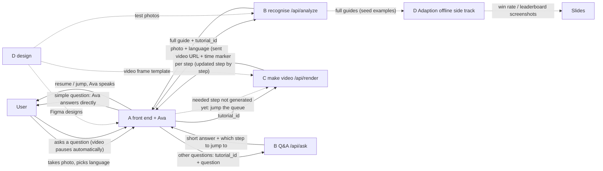

# HomeGuide: take one photo, learn your appliance in your own language

> Imperial AI Hackathon 2026 · Main track 02 Voice, Vision & Generative Media
> Sponsor prizes: **fal** + **Anam**　｜　Cross-track prizes: **Adaption**, **Figma**

**Authors**

| Name | Email |
|---|---|
| Yiding Wang | yiding.wang26@imperial.ac.uk |
| Yunqi Wang | yw4726@ic.ac.uk |
| Dory Zhu | dz726@ic.ac.uk |
| Jennifer Liu | jennifer.liu26@imperial.ac.uk |

## 1. Overview

In the UK, many people's first language is not English: international students, new immigrants, elderly immigrants, short-term visitors. The washing machine in a student hall, the oven and the heating controller in a rented flat: their panels are covered in English abbreviations and are easy to get wrong.

**How it works:**

1. Open the app. The digital tutor **Ava** greets you in your native language.
2. Take a photo of the appliance's control panel.
3. The AI recognises the brand, model and buttons, looks up the manual online, and writes the **full guide** for this appliance (every button + every step).
4. It generates a **native-language lesson video with step markers**: the button to press is **marked on the real photo**, the presenter is **lip-synced**, and there are **bilingual subtitles**. Playback starts as soon as step 1 is ready; later steps are generated while you watch.
5. Ask while you watch: the moment you speak, the video **pauses automatically**, Ava answers in a sentence or two, then **playback continues**, or it **jumps to the relevant step**.

**Design principle: the photo is recognised only once, and each step's video is generated at most once.**

| Order | What | Who | Input | Output | Times per session |
|---|---|---|---|---|---|
| ① Recognise | Identify the model, look up the manual, write the full guide | Claude | Photo + language | Full guide + `tutorial_id` | **Once** |
| ② Make the video | Generate step by step, join into one video with time markers | fal + ffmpeg | Full guide + photo | Video + time marker per step | **At most once per step** |
| ③ Q&A | Classify the question, give a short answer or a jump position | Ava / Claude | `tutorial_id` + question | Short answer + which step to jump to | Once per question (very cheap) |

Why it is designed this way:

- **No repeated image recognition**: after recognition the full guide is stored on the server; later questions only send the `tutorial_id`, never the photo again.
- **No repeated video generation**: if the user asks "how do I do a quick wash" and that step has already been generated, we simply **jump to that timestamp** without re-rendering.
- **No waste**: videos are generated one step at a time in viewing order; if a question needs a step that isn't generated yet, that step **jumps the queue**; when the user leaves, generation **stops**, so nothing is paid for that nobody saw.
- **Q&A is cheap**: Q&A sends the model only a compact table of contents, not the full narration or the source links; simple questions Ava can answer herself without calling any endpoint.

**Safety design**

- The marker boxes are drawn **in code** on the **real photo**; the AI never invents a picture of the appliance, which avoids marking the wrong button.
- Every step carries its **sources** (official manual / forums); an **inspector AI** checks step by step and deletes any step that does not match the photo.
- **Red lines**: for gas, electrical repair, boiler dismantling and similar operations, no tutorial is generated; only the contact details of official support or the landlord are given.
- When unsure, it honestly says "I'm not sure" and never makes things up (the step data has a `model_confidence` field).

**Adaption side track (cross-track prize, done offline)**

In the main system, "rewriting an English manual into simple native-language steps" is done by Claude. Separately, we use **Adaption** to teach the same thing to a **small open-source model**: generate training data with Adaption → fine-tune automatically → score against the original model, and present the improvement on the leaderboard as our cross-track result. This side track is **not wired into the main flow of the live demo**; the results are only shown in the slides (see section 7).

---

## 2. Quick start

```bash
npm install
cp .env.example .env   # fill in ANTHROPIC_API_KEY and ANAM_API_KEY
npm start              # http://localhost:8000
```

- It runs without any keys: it enters **demo mode** automatically (a sample Japanese washing-machine panel + Ava's still image + browser text-to-speech), so you can see the effect first.
- Using it on a phone needs HTTPS (camera / microphone permission): deploy to any HTTPS host, or use a local tunnel such as `ngrok http 8000`.

---

## 3. What each tool is responsible for

| Tool | In one sentence | Responsible for | Not responsible for |
|---|---|---|---|
| **Anam** | The digital human's **face and real-time conversation** | Ava on screen; listening to the user, answering in real time, lip sync; **calling client tools** to pause / resume / jump the video and circle buttons; answering simple questions directly | Does not look at photos or write steps |
| **ElevenLabs** | **Voice** (optional) | If Anam's built-in voice is not natural enough in some language, replace it with this | Is not the digital human's face |
| **Claude** | **The brain** | Looks at the photo, identifies the model, looks up the manual online, writes and translates the full guide; acts as inspector; judges red lines; answers what Ava can't and gives the jump position; adds English subtitles to Ava's improvised answers | Does not generate images, video or audio |
| **fal** | **Generates video material** (planned) | Native-language narration for each step, presenter lip sync, light animation of the photo | Does not draw marker boxes (drawn in code); does not join videos (ffmpeg does) |
| **ffmpeg** | **Joins the video** (planned) | Joins each step's clip into one video and records each step's start and end time; overlays markers and bilingual subtitles | |
| **Figma** | **UI design** | The phone UI, the video frame template, the style of the QR-code sticker | Does not write code |
| **Adaption** | **Teach a small model to write native-language steps, for the cross-track prize** | Use **Invent a Dataset** to generate training data for "English appliance instructions → simple native-language step-by-step instructions" from a task description; use **AutoScientist** to optimise the data and training settings together and fine-tune automatically; look at the fine-tuned model's win rate against the original model and its leaderboard rank | **Not wired into the main system** (the platform does not yet support calling the fine-tuned model online); does not look at photos or make videos |

---

## 4. Who does what

| Member | Role | Tools | Files owned |
|---|---|---|---|
| **A** | Front end + digital human | Anam, ElevenLabs | `public/`, `persona.js`, `languages.js`; the video player (step markers, pause / resume / jump) |
| **B** | Brain | Claude | `/api/analyze`, `/api/ask`, `/api/translate` in `server.js`, and the prompts |
| **C** | Video factory | fal, ffmpeg | `/api/render`, the `/api/render/:id` status query; generating and joining step by step |
| **D** | Design + cross-track prize + demo | Figma, Adaption | `design/`, `docs/`, `adaption/` (training data, evaluation set, result screenshots) |

If there are only 3 people: Figma goes to A; Adaption and the slides go to B.

> Hand-over point between B and D: B's prompts and the full guides in `output/guides/` are D's **seed examples and evaluation reference answers** for the Adaption data. B tells the group after changing the prompts.

---

## 5. Data flow



> The dashed line `B1 → Adaption → Slides` is the offline side track; it does not affect the real-time flow of A, B and C.

### Whose data goes to whom

| # | From | To | Content | Format |
|---|---|---|---|---|
| 1 | User | A | Appliance photo + chosen language | JPG / PNG |
| 2 | A | B | Photo + language | Call `POST /api/analyze` |
| 3 | B | A | **Full guide** + `tutorial_id` | JSON (see 7.1) |
| 4 | A | C | `tutorial_id` | Call `POST /api/render` |
| 5 | C | A | Video URL + time marker per step, updated each time a step is ready | JSON (see 7.2); the front end polls `GET /api/render/:id` |
| 6 | A | B | `tutorial_id` + question + current step | Call `POST /api/ask` |
| 7 | B | A | Short answer + button to circle + which step to jump to | JSON (see 7.3) |
| 8 | A | C | Steps that need to be generated first | Call `POST /api/render` with `priority_steps` |
| 9 | B | A | Red-line notice: reason + official contact details | The full guide only has `warnings`; rows 4–8 are skipped |
| 10 | B | D | Prompts + a few full guides (with the English source excerpts in `sources`) | `output/guides/*.json`; D turns them into training examples (see 7.4) |
| 11 | D | Slides | Before/after fine-tuning comparison, leaderboard rank | Screenshots + `adaption/results.md` |

> Rows 6–8 happen once per question, but **the photo is never recognised again and existing steps are never regenerated**.

### Where each input is used

| Input | Where it is used |
|---|---|
| ① Appliance photo | Recognition (used only once); drawing markers in the video |
| ② The language the user picked | The narration is written in this language + the digital human's speaking / dictation language |
| ③ The user's question about this appliance | **Not part of recognition**; handed to Ava or `/api/ask` to decide what to answer and which step to jump to |

> **Rule: everyone develops against sample data first and does not wait for anyone else.** The demo-mode data is in `demo.js` and can be used directly as a sample step JSON.

---

## 6. Endpoints

### 6.1 Recognise: `POST /api/analyze` (B)

- Input: photo + `language`.
- Two stages:
  1. Claude looks at the photo and identifies the **brand and model**, uses web search / web fetch to look up the **official manual** and **forum answers** online, and writes research notes.
  2. It looks at the photo once more and organises the notes into the structured **full guide**: each button's coordinates on the photo, bilingual narration, the sources each step cites, tips, and safety warnings.
- Output: the full guide (see 7.1), which carries the `tutorial_id`. It is saved to `output/guides/<tutorial_id>.json`; the lesson page has a "Download steps JSON" link.
- The front end shows the search keywords in real time.
- The Claude request has server-side refusal fallback turned on (`fallbacks: "default"`); if it is refused by the safety policy it automatically retries with another model.

**This is the only time in the whole session that the photo is sent to a model.**

### 6.2 Make the video: `POST /api/render` and `GET /api/render/:tutorial_id` (C)

- Input:
```json
{ "tutorial_id": "abc123", "priority_steps": [3, 4] }
```
`priority_steps` is optional: when a question needs steps that aren't generated yet, the front end passes them in so they jump the queue.

- What it does:
  1. Reads the full guide from `output/guides/<tutorial_id>.json` and queues the steps in order.
  2. Generates one clip per step (fal makes the narration and lip sync, code draws the markers, ffmpeg overlays the subtitles).
  3. Each time a step is ready, appends it to the end of the full video and records that step's start and end time.
  4. Steps that have already been generated are **skipped**, so calling it again costs nothing extra.
  5. If the front end has not polled for a while (the user has left), it **stops** generating the remaining steps.
- Output: the video manifest (see 7.2). The front end polls `GET /api/render/:tutorial_id` to get the latest manifest.

**Fallback if time runs out:** don't join a full video; return the list of small per-step videos and let the player play them in order. Jumping and replaying still work, and the demo looks about the same.

### 6.3 Q&A: `POST /api/ask` (B)

**Triage first; don't call the endpoint if you don't have to:**

| Question type | Example | Who answers | What the front end does |
|---|---|---|---|
| Answerable in one sentence | "What does this button do?" | **Ava answers herself** (the step data is already in her system prompt); no endpoint call | Pause → circle the button → Ava answers → resume |
| The task is in the guide | "How do I do a quick wash?" | `/api/ask` | Pause → Ava says one sentence → jump to the matching step and play |
| Not in the guide | "Can it tumble dry?" (this one can't) | `/api/ask` | Pause → Ava says "I'm not sure" and suggests checking the official source → resume |

- Input:
```json
{ "tutorial_id": "abc123", "question": "怎么快洗？", "current_step": 2, "language": "zh" }
```
- What it does: the server uses the `tutorial_id` to fetch the full guide and **sends the model only the compact table of contents**: each button's name and function, and a one-sentence summary of each step. The full narration and the source links are not sent, and neither is the photo. The model decides which type the question is and returns a very short result. When the answer isn't in the guide, it honestly says "I'm not sure" and does not invent steps.
- Output: see 7.3.

### 6.4 Adaption side track: fine-tuning a small model (D, offline)

**Goal**: teach a small open-source model the step Claude does in the main system: rewriting an English manual excerpt into **short, conversational, numbered** native-language instructions, and refusing red-line operations with advice to contact official support.

**Steps:**

1. **Write the task description** (final by Saturday 16:15): one paragraph describing the behaviour the model should learn, e.g. "The input is an English appliance manual excerpt and a target language; the output is 3–6 simple native-language operating steps, one sentence each, using only information from the manual, and saying it is unsure when unsure; for gas, electrics or boiler dismantling, give no steps and only advise contacting the landlord or official support".
2. **Generate data**: give the task description and 5–10 seed examples (from `demo.js` and `output/guides/`) to **Invent a Dataset** to generate instruction data (paired "input → reference answer" examples); format in 7.4.
3. **Check the data** (D spot-checks 30–50 rows): delete examples that invent buttons, have steps that are too long, are in the wrong language, or let a red line through. At least 10% of examples are red-line cases and 10% are "not in the guide, should say unsure" cases.
4. **Hold out an evaluation set**: prepare another 30–50 examples that **are not used for training** (ideally from the 3 appliances we really photographed), used only for scoring.
5. **Fine-tune**: use **AutoScientist** to pick a small model as the base, tune the data and training settings automatically, and run the full fine-tune.
6. **Read the results**: record the fine-tuned model's **win rate** against the original base model and its leaderboard rank; screenshot the 2–3 examples with the clearest before/after difference. Write the results into `adaption/results.md` for the slides.

**What we don't do**: we don't wire the fine-tuned model into `/api/analyze` or `/api/ask`; the live demo runs entirely on Claude. The slides can say "next step: use this small model in place of some Claude calls to lower the cost per appliance".

---

### 6.5 QR code: scan to watch this lesson again

- **When it is generated**: when `/api/render` or `GET /api/render/:id` returns `status: "done"` (every step's video is ready), the manifest gains a `share` field, and the QR code is saved to `output/qr/<id>.png`, `.svg` and `.txt` (the link), ready to print as a sticker. A lesson with no fal videos, where times are only estimated from the narration, also counts as "ready". No QR code is generated for red-line (`blocked`) guides.
- **The link in the QR code**: `<public address>/?t=<id of the original guide>`. It uses the original id (`media_id`), so **all languages share one QR code** for the same appliance.
- **Public address**: `PUBLIC_URL` in `.env` is used first; if it is empty, the address currently being visited is used, and when that is `localhost` it is replaced with the computer's LAN IP (phones on the same Wi-Fi can open it). Voice questions on a phone require https, so for the demo we recommend setting `PUBLIC_URL` to an ngrok address.
- **After scanning**: the home page shows "Existing lesson: appliance name"; the user picks their language and taps "Start" to go straight into the lesson: **no photo, no recognition, no video regeneration**. Another language is translated once the first time it is opened, then read from cache. Ava can still take questions and jump as usual.

| Endpoint | Description |
|---|---|
| `GET /api/qr/<id>.png` / `.svg` | The QR code image; `.png?download=1` downloads it directly |
| `GET /api/guide/<id>?lang=zh` | Fetches the guide when opened from a scan (in this language); `guide.demoImage` points to the photo |
| `GET /api/photo/<id>` | The appliance photo for this guide |

```json
"share": { "url": "https://xxxx.ngrok-free.app/?t=abc123", "qr_png": "/api/qr/abc123.png", "qr_svg": "/api/qr/abc123.svg", "secure": true }
```

## 7. Data formats

### 7.1 Full guide (output of `/api/analyze`)

```json
{
  "schema": "appliance-tutor/guide@2",
  "tutorial_id": "abc123",
  "brand": "Panasonic",
  "model": "NA-F70PB15",
  "model_confidence": "high",
  "language": "zh",
  "appliance_native": "全自动洗衣机",
  "appliance_en": "Washing machine",
  "buttons": [
    { "id": "b1", "panel_text": "電源", "name_native": "电源键", "function_native": "…",
      "box": { "x": 40, "y": 400, "w": 90, "h": 150 } }
  ],
  "steps": [
    { "step": 1, "button_id": "b1", "action_native": "按电源键",
      "narration_native": "…", "narration_en": "…", "sources": ["https://…"] }
  ],
  "tips":     [{ "native": "…", "en": "…" }],
  "warnings": [{ "native": "…", "en": "…" }],
  "sources":  [{ "id": 1, "title": "…取扱説明書", "url": "https://…", "kind": "web", "cited": true }]
}
```

| Field | Description |
|---|---|
| `tutorial_id` | The id of this tutorial; video and Q&A both use it to fetch context afterwards |
| `model_confidence` | Confidence in the model identification: `high` / `medium` / `low`; when low, Ava should say "I'm not sure" |
| `buttons[].box` | The button's position on the photo: top-left `x`, `y`, width `w`, height `h`, in pixels |
| `buttons[].panel_text` | The original text printed on the panel |
| `steps[].button_id` | Which button to press in this step; matches `buttons[].id` |
| `steps[].action_native` | A one-sentence summary; the compact table of contents for `/api/ask` uses it |
| `steps[].narration_native` / `narration_en` | The native-language narration the presenter reads / the English subtitle |
| `steps[].sources` | Links to the sources this step is based on |
| `warnings` | Safety warnings; when a red line is crossed no steps are generated, only the reason and official contact details |

### 7.2 Video manifest (output of `/api/render`)

```json
{
  "tutorial_id": "abc123",
  "status": "rendering",
  "video_url": "/media/abc123_full.mp4",
  "chapters": [
    { "step": 1, "start": 0.0,  "end": 12.4, "ready": true },
    { "step": 2, "start": 12.4, "end": 25.1, "ready": true },
    { "step": 3, "ready": false },
    { "step": 4, "ready": false }
  ],
  "clips": [
    { "step": 1, "url": "/media/abc123_step1.mp4" },
    { "step": 2, "url": "/media/abc123_step2.mp4" }
  ]
}
```

| Field | Description |
|---|---|
| `status` | `rendering` still generating / `done` all finished / `stopped` stopped after the user left |
| `video_url` | The full video joined so far |
| `chapters[].start` / `end` | This step's start and end time in the full video (seconds); the player uses them to draw step markers, jump and replay |
| `chapters[].ready` | Whether this step is ready; when it isn't, the front end shows "preparing" and Ava keeps the user company |
| `clips` | The separate small video for each step (used by the fallback plan) |

Videos are stored by "**appliance model + step + language**", so the same washing machine can be reused directly for another user or another question.

### 7.3 Q&A result (output of `/api/ask`)

```json
{
  "type": "jump",
  "answer_native": "快洗用 Quick 15，我带你看第 4 步。",
  "answer_en": "Use Quick 15 — let me take you to step 4.",
  "highlight_button": "b6",
  "jump_to_step": 4,
  "resume": false
}
```

| Field | Description |
|---|---|
| `type` | `answer_only`: just answer / `jump`: answer then jump to a step / `unsure`: not in the guide |
| `answer_native` / `answer_en` | A short answer of one or two sentences; Ava reads the native-language one, the subtitle shows the English |
| `highlight_button` | The button to circle on the photo (optional) |
| `jump_to_step` | Which step to jump to when `type = jump`; if that step isn't generated yet, the front end calls `/api/render` to make it jump the queue |
| `resume` | `true`: after answering, continue playback from where it paused |

**Tell the group before changing a format**, because A, B and C all depend on it.

### 7.4 Adaption training examples (`adaption/train.jsonl`, `adaption/eval.jsonl`)

One "input → reference answer" per line:

```json
{
  "prompt": "Target language: zh\nAppliance: washing machine (Panasonic NA-F70PB15)\nManual excerpt: \"Press POWER. Select WOOL with the COURSE button. Press START/PAUSE.\"\nTask: Write simple numbered steps in the target language.",
  "completion": "1. 按电源键开机。\n2. 按“程序”键，选到“羊毛”。\n3. 按“开始/暂停”键开始洗。"
}
```

The reference answer for a red-line example contains only the reason and the advice, e.g. `"这一步涉及燃气，不建议自己操作。请联系房东或品牌官方售后。"`

| File | Content | Rows (suggested) |
|---|---|---|
| `train.jsonl` | Training examples generated by Invent a Dataset and spot-checked by D | A few hundred to a few thousand |
| `eval.jsonl` | Held-out evaluation examples, **not used for training** | 30–50 |
| `results.md` | Base model, win rate, leaderboard rank, before/after examples | — |

---

## 8. The digital human Ava

A saved persona **"Ava – Appliance Tutor"** has been created in the Anam account and can be previewed directly in Anam Lab.

| | ID | Description |
|---|---|---|
| Persona | `f18ab547-696d-4787-aab3-9cc1f7644599` | The saved version in Anam Lab |
| Avatar | `edf6fdcb-acab-44b8-b974-ded72665ee26` | Mia – studio (photorealistic), rendering model `cara-4` (lip sync) |
| Voice | `90313ddc-4fc0-11f1-84b0-52bacf74fa75` | Amanda – Warm Guide, American English (Cartesia sonic-3.6) |
| LLM | `65421f1c-c7de-4bc4-ac27-d171c16ef41f` | Qwen 3.8 27B (hosted by Anam, low latency, supports tool calling) |

All defined in `persona.js`. When English is chosen, Ava's English voice is used; for any other native language it switches to a female voice in that language, with the same avatar and model.

**Two session phases:**

- **greet**: Ava greets with `initialMessage` and keeps the user company while they take the photo.
- **lesson**: reconnects after recognition, writes the full guide into the system prompt, and gives Ava client tools: `next_step` / `previous_step` / `repeat_step` / `go_to_step` / `highlight_button`, plus the video controls `pause_video` / `resume_video`.
  - The user says "next" or "say it again": Ava calls a tool and the player jumps or replays by step marker, **without regenerating anything**.
  - The moment the user starts a question: `pause_video` first; Ava answers simple questions herself (with `highlight_button` if needed) and then `resume_video`; what she can't answer goes to `/api/ask`, and the result decides whether to jump or continue.

(Anam cannot change the system prompt mid-session, so the lesson phase reconnects once, which takes about 1 second.)

| Other features | Implementation |
|---|---|
| Photo markers | The current step's button gets an orange pulsing ring + the step number; the button Ava is pointing at while explaining is pink; the digital human's picture-in-picture moves out of the way of the buttons automatically |
| Bilingual subtitles | Narration: the native language lights up character by character + English; Ava's improvised answers: Claude adds a line of English after she finishes |
| Step markers | Each step is drawn on the player's progress bar from `chapters`; click one to jump there |
| Lesson video export | The ● at the top right records, combining the photo, markers, digital human, subtitles and sound into MP4 / WebM |
| QR code | When all lesson videos are ready, a ▦ button appears at the top right with a notice; open it to download / copy. Scanning goes straight into this lesson (see 6.5) |

---

## 9. File structure

```
.
├── README.md
├── .env.example        # API key template (no real keys)
├── server.js           # /api/analyze, /api/ask, /api/render, /api/session-token, /api/translate
├── persona.js          # Ava's avatar / voice / model IDs, prompts, client tools
├── languages.js        # 10 native languages, each with an Anam native voice + UI strings
├── demo.js             # Demo-mode data (also a sample step JSON)
├── public/             # Front end (no build step), includes demo-panel.svg
├── output/guides/      # Full guides; the file name is the tutorial_id
├── output/media/       # Each step's video clip and the joined full video
├── output/qr/          # QR codes generated automatically once a lesson is ready (png / svg / link)
├── design/             # D: Figma links, screenshots
├── adaption/           # D: task description, train.jsonl, eval.jsonl, results.md, leaderboard screenshots
└── docs/               # D: demo script, slides
```

Supported languages: 中文, English, Español, Tiếng Việt, 日本語, 한국어, Français, العربية, हिन्दी, Português. To add a language, copy one entry in `languages.js`.

---

## 10. API keys and settings

| Variable | Description |
|---|---|
| `ANTHROPIC_API_KEY` | Required (demo mode if empty) |
| `ANAM_API_KEY` | Required (demo mode if empty) |
| `FAL_KEY` | Needed for fal videos |
| `ELEVENLABS_API_KEY` | Optional |
| `ADAPTION_API_KEY` | Only needed when D works on the Adaption side track; the main system does not read it, and leaving it empty does not affect the demo |
| `ANAM_AVATAR_ID` / `ANAM_LLM_ID` | Change the digital human's avatar / Ava's conversation model |
| `CLAUDE_MODEL` | Change the Claude model |
| `PORT` | Port, default 8000 |
| `PUBLIC_URL` | The public address in the QR code (e.g. an ngrok https address); if empty, the current address / LAN IP is used automatically |

**Automatic rotation across several keys:** one service can have several keys (`NAME`, `NAME_2`, `NAME_3` …, see `.env.example`). The first is used first; when it runs out of credit / fails authentication / is rate-limited, the next one takes over automatically. JavaScript uses `keys.js` (`withKey` / `fetchWithKey`), Python uses `keyring.py` (`KeyRing`); Claude, Anam and fal are already wired up, and newly added services (ElevenLabs, Adaption) should go through these two files as well.

**The agent that changes the code automatically:** `npm run agent -- --prompt AGENT_PROMPT.md --branch tonight-demo` creates a separate workspace next to the project and has Claude work on that branch according to the task file. When one Claude account's credit runs out it switches to the next key automatically and continues the same conversation; after an interruption, running the same command again carries on. It does not push and does not change `.env`. By default there is no total spending cap (when one key is used up it moves to the next); use `--max-usd` to set one. For usage see the top of `tools/run_agent.mjs`, or `npm run agent -- --help`.

⚠️ **`.env` is listed in `.gitignore`. Never commit real keys to GitHub.** Once the repository is public, the keys will be stolen and the credit used up very quickly.

---

## 11. Timetable and sync points

| Time | A front end + digital human | B brain | C video factory | D design + cross-track prize |
|---|---|---|---|---|
| **Sat 15:50–16:15** | Register with Anam, get the official example running | Hand-write sample step data | Register with fal; ask fal's agent which models to use | Photograph 3 appliances; write the Adaption task description + 5–10 seed examples, start Invent a Dataset |
| 🚩 **16:15 sync** | Sample data, photos and API keys all in place | | | |
| **16:15–20:00** | Web page + Ava speaking Chinese; define the tools | Photo → full guide; test whether button positions are accurate | Sample data → a video clip per step | Hand over Figma designs by 17:00; spot-check the Adaption data (delete bad examples, add red-line and "unsure" examples); prepare the evaluation set |
| 🚩 **20:00 sync** | A's page is interactive, B can handle real photos, C can produce each step's video | | | |
| **20:00–23:00** | **Priority ③**: a question pauses automatically → Ava answers briefly → playback continues | **Priority ②**: `/api/ask` fetches context by `tutorial_id` and sends only the compact table of contents; inspector + safety red lines | **Priority ①**: join into a full video + step time markers; skip steps already generated | Start fine-tuning with AutoScientist (runs overnight); first draft of the slides; act as test user |
| 🚩 **23:00 sync** | **Working end to end, rough is fine** | | | |
| **Sun 9:00–12:00** | Jump / replay by step marker; keep the user company while waiting; apply the design | Polish Q&A; add a second language | Voice and lip sync for the second language; bilingual subtitles | Read the win rate and leaderboard, screenshot before/after examples, write `adaption/results.md`; QR-code page; final slides |
| 🚩 **12:00 sync** | **Feature freeze, record the backup demo video** | | | |
| **Sun afternoon** | Operate live | Prepare for technical Q&A | Bug fixes only | Lead presenter |

**Tonight's three priorities (suggested order: ② → ③ → ①)**

| No. | Content | Owner | Why this order |
|---|---|---|---|
| ② | `/api/ask` fetches context by `tutorial_id` and sends only the relevant information | B | Smallest change; A's pause logic depends on its return format |
| ③ | A question pauses automatically → short spoken answer → playback continues | A | Once ② is connected, multi-turn Q&A can be demonstrated |
| ① | Full video + step time markers; jumping and replaying without re-rendering | C | The most work; if time runs out, use the "small video per step + playlist" fallback |

With these three done, multi-turn Q&A runs smoothly, and two kinds of cost are avoided: repeated image recognition and repeated video generation.

**Sunday morning priorities**

1. A stable demo route: the same route runs 5 to 10 times without error; handle slow and failed cases. **For the washing machine used in the demo, generate all videos in advance.**
2. Highlights: asking while watching, a second language, the red-line demo, the video frame.
3. Only if there is time: generate while watching + queue-jumping for question steps, stop generating when the user leaves, the QR code, overall polish.

The Adaption side track **does not compete for people** with the three levels above: fine-tuning runs in the background, and D only needs to collect the results and take screenshots on Sunday morning. If there are still no results by Sunday 11:00, the slides show the dataset and the evaluation method and say "fine-tuning in progress".

If it isn't working on Saturday night, Sunday morning is **integration only**, and level 3 is cut entirely.

---

## 12. Three-minute demo script

1. **(30 s) The pain point**: an international student who has just arrived in London uses the washing machine in their hall for the first time; the panel is all English abbreviations, and they shrink a jumper.
2. **(90 s) Live demo**: take a photo → Ava says in Chinese "one moment, I'm looking up the manual", and the screen shows the keywords being searched → the lesson video starts: the button is marked on the photo, the presenter explains in Chinese, with bilingual subtitles and step markers on the progress bar → the user asks "what does this button do?", the video pauses automatically, Ava circles the button and answers in one sentence, the video continues → the user asks "how do I wash wool?", Ava answers in one sentence and the video jumps straight to the matching step.
3. **(30 s) Another person, another language**: switch the same washing machine to another language; then show a photo of a gas boiler being stopped by the red line.
4. **(30 s) Business model and technology**: the photo is recognised only once and each step's video is generated only once, so every tenant shares the same washing machine's videos; halls and landlords use QR-code stickers; where each sponsor's tool is used; Adaption: one slide showing "generate data with Adaption → fine-tune a small model → how much the win rate improved / leaderboard rank", plus one before/after example, and a note that the next step is to use this small model to lower costs.
